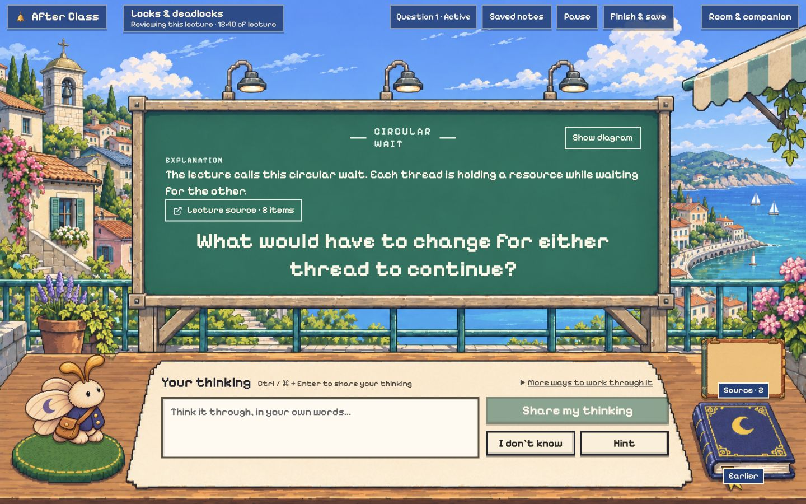

# After Class

After Class is a work-in-progress study companion for YouTube lectures. After a lecture, you explain the ideas in your own words while the exact passage or frame is a click away.



*The screenshot uses a sample lecture on locks and deadlocks with fixture data.*

## How it works

1. **Watch in Chrome.** The extension records which intervals you play, collects timestamped captions and samples video frames. A section you seek past stays out of the review.
2. **Prepare the evidence.** A local Bun backend groups watched material into concepts. Jev answers narrow questions, such as whether a slide change added a teaching step, and Claude uses the selected evidence to run a short Socratic review.
3. **Explain it.** Answer the question on the board in **Your thinking**. The folio opens lecture evidence, the notebook opens earlier exchanges, and **Saved notes** opens saved records. The record keeps your explanation apart from what the tutor added.

SQLite holds capture and review state, frame files live on disk, and the backend caches model results. Replay mode runs recorded paths with live model calls turned off.

## Hosted beta

An invite-only beta runs at [useafterclass.com](https://useafterclass.com) on one server, with Clerk sign-in. The server holds the model keys and caps spending at $5 per user and $50 in total each month. Testers install an extension build the maintainer sends them. Each release is a `v0.x` tag on master, deployed with `scripts/deploy-beta.sh`. The [infrastructure guide](infra/README.md) covers the server, keys, releases and costs.

## Try the study room

Install Bun (development uses 1.4.3), then run these from the repository root.

```sh
bun install --frozen-lockfile
bun run scripts/preview-ui.ts
```

Open [the local fixture preview](http://127.0.0.1:8770/?clean=1). It uses sample data and needs no extension, accounts or API keys.

## Run with a YouTube lecture

1. Build the extension with `bun run build:ext`. In Chrome, open `chrome://extensions`, enable **Developer mode**, choose **Load unpacked**, and select `dist/extension`.
2. In the repository's `.env` file, set `AFTERCLASS_EXTENSION_ID=<your-extension-id>` to the ID Chrome shows.
3. For live review, sign in to the Claude Code CLI so `claude` is on the backend's PATH. Put `TYPESAFE_API_KEY=<your-Jev-key>` in `~/.config/afterclass/keys.env` and run `chmod 600` on it. For a capture-only trial, skip this step and run `AFTERCLASS_MODE=replay bun run dev`.
4. Run `AFTERCLASS_MODE=live bun run dev`. The backend listens on `127.0.0.1:4317` and prints a pairing token. Paste it into the extension's options.
5. Open a YouTube lecture, start capture from the extension, and watch a segment with captions. Use the extension's review action when material is ready.

The [capture probe](docs/experiments/01-capture-probe.md) is a guided capture check.

## Verification and design

`bun run typecheck` runs the TypeScript checks and `bun test` runs the tests. `bun run build:app` and `bun run build:ext` build the two interfaces. Capture reliability, model quality and learning effectiveness remain open questions, and the [review flow](docs/flows/after-class.md) says how the project tests them.

- [Product requirements](docs/After%20Class%20-%20MVP%20PRD.md)
- [Architecture and module boundaries](src/MODULES.md)
- [Lifecycle models in TLA+](docs/flows/model/)
- [Current room and companion design](docs/design/front-row/README.md)
- [Visual review notes](docs/design/pixel-consistency/review.md)

## License

All rights reserved. See [LICENSE](LICENSE). Fonts, icons and the Meshy-generated companion frames keep their own licenses, listed there and shipped with the app in `asset-notices.txt`.
