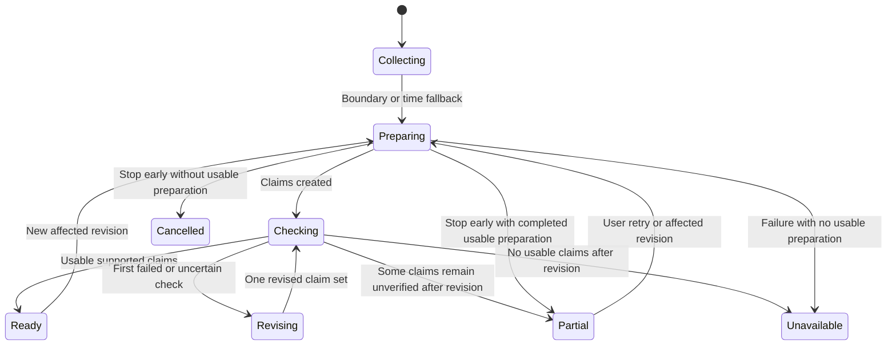

# After Class: MVP implementation-spec draft

Read the [MVP PRD](After%20Class%20-%20MVP%20PRD.md) for accepted product behavior and [grilling state](After%20Class%20-%20Grilling%20State.md) for decision provenance. This spec proposes contracts, orchestration, and delivery steps. Exact fields, technologies, thresholds, and error defaults are reviewable engineering proposals unless identified as accepted product decisions. No code or model probes were run to establish this architecture.

## System responsibilities

| Component | Owns | Does not establish |
| --- | --- | --- |
| Windows Chrome extension | Explicit activation, session-tab identity, capture health, watched intervals, transcript/frame acquisition, optional permitted audio capture | Universal YouTube access or reliable capture before a real probe |
| Local backend and evidence store | Keys, evidence IDs, alignment, source/processing versions, local jobs, cache, persistence, retention, usage ledger | Semantic accuracy merely because schemas and IDs validate |
| Jev adapter | Typed judgments on supplied text and relevant visuals: boundary signals, candidate visual significance, claim support | Open-ended concept writing or reliable lecture performance before evaluation |
| Interpretation worker | Concept descriptions, evidence links, assumptions, potential confusions, candidate resource connections | Learner mastery or certainty about why an answer was wrong |
| Resource worker | Load supplied sources; search after chunk closure; cache and link supplemental evidence | Permission to silently expand assessed material |
| Tutor service | Grounded recall, follow-ups, scenarios, hypotheses about reasoning, optional detours | Control of application permissions, capture scope, or state transitions |
| Review app | Speaking/typing, source inspection, partial status, disputes, notes, graph, cost display | Final UX design, which remains open |

The backend is local by product decision. SQLite, a local HTTP service, a browser-based review app, and a particular graph library are possible choices, not selected requirements. Tutor, voice, speech-recognition, and web-search providers remain open. Provider adapters should isolate request construction and usage reporting from product state.

## Proposed data contracts

| Record | Essential information |
| --- | --- |
| Source | Internal ID, canonical video identity, title/URL, transcript provenance, detected source revision and acquisition status |
| Capture session | Session/tab identity, activation/pause/end state, selected sources, watched media intervals, capture health and gaps |
| Evidence item | Source ID/version, media interval, transcript text or local readable-frame reference, provenance, capture/alignment status |
| Boundary observation | Exact input evidence references, separate concept-change/stopping-point judgments, returned probabilities, question/model version, timing context, code's routing outcome |
| Chunk revision | Ordered evidence references, watched intervals, coverage gaps, revision ID, boundary provenance, processing state |
| Concept claim | Description, evidence references, visually dependent flag, labeled assumptions, support-check outcome, revision count, processing version |
| Supplemental connection | Resource URL/provenance, target concept, short relevance explanation, supporting passages, retrieval state |
| Review | Included watched scope and chunk revisions, partial reasons, main-question count, soft time target, lifecycle state |
| Learning observation | Concept/question, actual learner turns, assistance given, assessment status, dispute/correction history and source references |
| Note and graph link | Stable identity, learner/tutor attribution, user edits, cited evidence, relationship type, suggested/accepted/corrected status |
| Job and usage event | Idempotency identity, input revision, attempt state, provider, units, reported/estimated cost, price basis, missing usage, cancellation and stale-result status |

Keep original capture references separate from OCR, labels, interpretations, and summaries. Code validates source ownership, evidence existence, interval validity, watched coverage, and record structure. A valid evidence reference does not mean it supports the claim; that requires the semantic check and independent evaluation.

## Jev questions and routing proposal

Every call receives the evidence needed to answer its questions; questions in one call must not depend on one another's answers. Keep wording, criteria, and thresholds in one versioned module. Do not pick final probability thresholds without representative tests.

| Judgment | Input | Yes means | No means | Uncertain/error outcome |
| --- | --- | --- | --- | --- |
| New concept | Rolling transcript window, preceding context, relevant frames as needed | The current passage introduces a materially different concept | It continues, elaborates, or exemplifies the current concept | Continue collection; use time fallback. Errors are not interpreted as no. |
| Stopping point | Same sufficient local context, preserving unfinished transitions | The preceding explanation has reached a coherent stopping point | A necessary step, example, or qualification remains unfinished | Continue collection; use time fallback. |
| Teaching visual change | Candidate before/after frames with nearby transcript | The change contributes relevant teaching content | The visible difference is irrelevant motion or duplicate content | Keep uncertain frames; do not delete originals needed by active/saved evidence. |
| Claim support | One generated claim, labeled source assumptions, supporting passages and necessary readable frames | Supplied evidence supports the claim in its stated scope | Evidence contradicts or does not support the claim | One revision attempt; otherwise unverified and excluded from assessment. |

A positive concept-change judgment alone does not trigger review. Code combines the two boundary judgments with watched coverage and timing. Duration/cooldown rules are proposals to tune, not reasons to invent certainty. Jev's visual calls and dense equation/code interpretation need direct testing.

Use a status such as `supported_by_check` internally to distinguish a passed model check from independently verified truth. The product's unverified state remains visible for claims not supported by the check. The support check is not a certificate of correctness.

## Proposed actor-tagged flow

The following consolidates the accepted behavior into a reviewable flow. It has not yet received user approval as a complete algorithm.

```text
[user] Start a capture session for a supported YouTube tab.
[code] Activate permitted capture; show source and capture health.
[code] If activation fails, show the failure and offer retry; do not invent evidence.
[code] While capture is active, collect watched intervals, transcript and frame candidates.
[code] If captions are unusable, offer the accepted opt-in transcription fallback.
[user] Accept transcription or continue with a visible transcript gap.
[code] If a channel fails, preserve successful evidence and record missing intervals.
[code] Load supplied resources without starting deeper concept analysis yet.
[Jev] Given candidate frames and transcript, judge teaching-content change:
      yes = relevant visual step; no = irrelevant/duplicate change.
[code] Keep meaningful and uncertain frames; apply tested deduplication to clear duplicates.
[Jev] Given rolling transcript context and needed frames, separately judge:
      new concept: yes = distinct concept; no = same concept development;
      stopping point: yes = coherent closure; no = unfinished explanation.
[code] On uncertainty/error, continue collection and apply time fallback without a false label.
[code] On accepted boundary/time closure, version the chunk and queue interpretation.
[code] Reuse valid cached preparation; otherwise run interpretation on captured watched evidence.
[agent] Write evidence-linked concepts, assumptions and possible confusions for the completed chunk.
[Jev] Given each claim and its passages/needed frames, judge support:
      yes = evidence supports this scoped claim; no = contradicted or unsupported.
[code] On yes, mark supported_by_check; on no/uncertain, request one revision.
[agent] Revise the claim against the evidence once; do not fabricate missing capture.
[Jev] Given the revised claim and evidence, judge support by the same criteria.
[code] If still unsupported/uncertain, mark unverified and exclude it from learner assessment.
[agent] In a separate job, find/read supplemental resources connected to supported lecture concepts.
[code] Store citations and relevance links; resource failure does not block core review readiness.
[code] Offer review at the accepted invitation point; keep Review now available.
[user] Choose Review now, Later, wait for preparation, or Stop early.
[code] On Later, carry material forward, continue preparation, and defer the next invitation.
[code] On wait, keep Processing visible; show an estimate only when reliable.
[code] On Stop early, cancel pending work for this preparation scope and retain completed results.
[code] Freeze a partial review scope from prepared material; keep capture and future material separate.
[code] If nothing supports a usable review, proposed fallback: explain gaps and offer retry/revisit.
[agent] Ask open recall, then up to three main questions with follow-ups as needed.
[user] Speak/type an answer, skip, request help, dispute, pause, or end.
[agent] On a mismatch, ask a tentative source-grounded diagnostic question.
[user] Choose whether to take a proposed prerequisite detour.
[agent] On a dispute, recheck source and show evidence; preserve unresolved disagreement.
[code] At a natural pause beyond the soft target, offer continue or wrap up.
[code] If later evidence changes a boundary, version and reprocess affected interpretation only.
[agent] Disclose any affected active-review correction and cite supporting evidence.
[code] Save notes, observations, suggested graph links and evidence references locally.
[code] On save failure, proposed fallback: retain a recoverable pending save and offer retry.
[code] Record usage throughout; show unknown data explicitly and impose no personal-MVP spend cap.
[user] End capture/review independently; inspect, correct, revisit, or delete saved material.
[formal] After the user's own rules and flow approval, model-check lifecycle transitions.
```

No user-authored invariant sentences have been collected. The final formal-check line is a pending review stage, not a runtime component and not completed work. The no-usable-review and pending-save behaviors above are engineering proposals filling explicit open branches.

## Lifecycle and concurrency proposals

Capture, interpretation, resource loading, and review have independent lifecycles. Choosing Later does not cancel preparation. Starting review does not automatically stop capture. Resource completion does not silently expand a review's included scope.

The diagram below sketches a single chunk's preparation; it is illustrative, not generated from a checked formal specification.



Mixed claim sets are aggregated by code: ready/partial means there is usable material, not that every claim passed. A retry after failure reuses accepted artifacts; a new source revision is not an unlimited excuse to repeat failed checks. Define the exact cancellation boundary before coding.

Each job carries its input source/chunk revision. Proposed rule: a late result from an obsolete revision may be retained for diagnostics but cannot overwrite current preparation or a corrected note. Cancellation requests must be acknowledged and pending callbacks isolated. Stable note IDs and transactional saves should make retry idempotent. These are engineering safeguards, not claims of implemented behavior.

The flow skill calls for user-written rules followed by a TLA+/TLC lifecycle check using its statechart workflow. Those steps are pending because the user requested a draft for later review and implementation elsewhere. No invariant was fabricated, no TLC run occurred, and the diagram above must not be presented as formally verified. Capture code would still need real integration tests even after a model check passes.

## Cache, retention, and local secrets

Proposed cache identity includes canonical source identity, observed source/transcript revision, captured interval coverage, selected evidence revision, model/question versions, and processing configuration. Personal learning history is not a shared source cache. Review scope is determined by watched coverage, even if a wider source cache exists.

Track note-to-evidence references so the accepted thirty-day expiry applies only to uncited raw captures. Keep saved-note evidence until explicit deletion. Deletion must make unavailable evidence visible rather than leaving a citation that appears retrievable. Local database choice, secret storage, disk quotas, and exact cleanup mechanics remain to select.

Usage accounting should separate returned provider units from estimated money. Record the pricing basis, transcription/voice/search charges, cached calls, and failed requests where known. Unknown usage/cost stays unknown. Uncapped personal use does not justify unbounded retries or runaway search; select bounded job concurrency and search depth during engineering.

## Delivery sequence for the separate implementation session

1. Review these drafts and identify unresolved choices. Select stack/provider defaults explicitly as engineering proposals and document their rationale. Do not describe them as prior user decisions.
2. Probe the real Windows Chrome path: code-driven captions/transcript and frame capture, timestamps, pause/seek/speed handling, gaps, and permitted audio fallback. Produce an inspectable evidence bundle before building a large UI.
3. Exercise Jev with representative text and visual cases. Inspect exact inputs and judgments; tune on one split and evaluate on different lectures. Establish actual accuracy, timing, and cost. The draft is not a separate authorization for paid experiments; confirm live-call scope in that session.
4. Complete one capture-to-preparation-to-review-to-local-record path, including the necessary diagram/equation case agreed for acceptance. Keep supplemental work asynchronous.
5. Add repeat-view cache, graph suggestions and progress overlays, voice/text controls, correction/dispute handling, partial states, and data retention. UX design should shape the review experience before final UI implementation.
6. Run held-out quality and failure checks, create a labeled replayable sample, and report measured behavior and limitations. Avoid claims of production integration or learning efficacy based only on mocks or focused tests.

## Verification matrix

| Area | Inspectable evidence required |
| --- | --- |
| Real capture | Supported video/browser path, timestamped transcript and readable frames, source comparisons, pause/seek/speed and missing-channel results |
| Jev preprocessing | Input bundles, separate judgments, probabilities, versioned routing, uncertain and negative cases; evaluate unchanged-slide topic changes and same-topic slide changes |
| Interpretation accuracy | Human/source audit of concepts, claims, assumptions, visual steps and evidence links; report false support checks as errors |
| Tutor | Real learner turns, source-grounded questions, hinted versus independent answers, skipped/unassessed outcomes, disputes and detour consent |
| Local persistence | Saved note, retained cited evidence, no duplicate notes on retry, restored session, correction attribution |
| Partial/failure flow | Capture gaps, still-processing review, stop early, one failed revision, no usable evidence, resource failure, save retry and stale callbacks |
| Repeat viewing | Cache hit/miss reasons, source/processing invalidation, correct watched scope and preserved learning history |
| Cost and delay | Per-stage measured usage/latency, estimates labeled, unknown charges exposed; no assumed savings |

Numerical release thresholds and voice-provider quality targets are still open. Define them before the final evaluation rather than retrofitting a passing bar to observed results. No tests, measurements, or formal checks have been performed as part of writing this spec.
