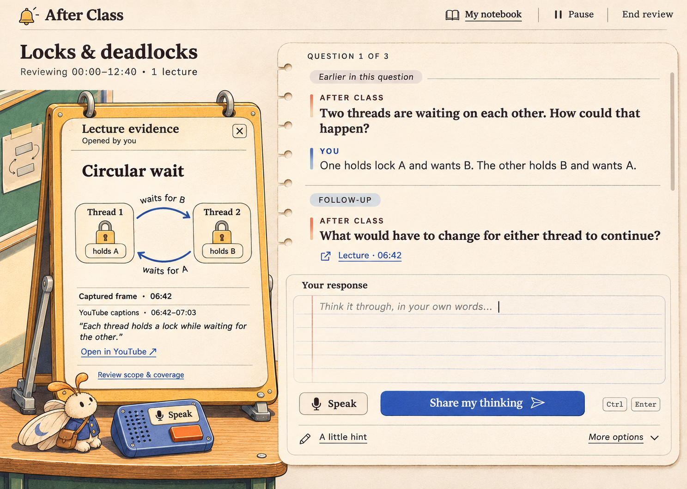

# After Class: scenes and companions implementation handoff

Design approval: Derek, 2026-11-03. This handoff packages approved visual references and a proposed implementation sequence. The scene skins, companions, and redesigned components are not implemented by this commit.

## Start here

Implement one tutoring experience with three selectable room skins and six selectable companion options. Room and companion selection are independent. Use **The Last Desk + original Mote** as the recommended initial defaults; Derek explicitly favored Mote, while the exact default combination is an engineering recommendation.

1. Open the [visual gallery](index.html). It works as a local file after cloning; it does not depend on this chat or the original preview server.
2. Read the [approved component mockup](component-review-2026-11-03/conversation-and-source.png). This is the primary target for readable conversation, history, composer, and evidence layout.
3. Read the implementation steps and acceptance checks below, then inspect their owning source files before editing. The code snapshot inspected for this handoff was `b5b9f38`; reconcile subsequent changes on the MacBook.
4. Begin with the shared workspace in Last Desk, then add the other scenes and companion selection. Another mascot or broad visual-ideation round is not required.

The [approved product flow](../flows/after-class.md), [repository instructions](../../CLAUDE.md), and [module contracts](../../src/MODULES.md) govern behavior. This document governs the new presentation. Older planning documents can contain superseded approval/status statements; use the approved flow for current lifecycle rules. Keep the existing backend and wire contracts as the source of truth.

## Approved visual direction

After Class should feel like the small, inviting space where you stay after a lesson to work something out. The user likes detailed isometric objects, tools that respond to interaction, warm paper, and companions reminiscent of animation familiars. Tutoring and learning remain the focus.

The early conventional dashboards were rejected. The three illustrated scenes were accepted as selectable skins. All six companion studies were welcomed. The later conversation/source mockup was explicitly signed off before this handoff was requested.

| Reference | Authority and use |
| --- | --- |
| [Conversation notebook + source viewer](component-review-2026-11-03/conversation-and-source.png) | Approved functional composition: chronological exchanges, attribution, current follow-up, citation, anchored composer, adjacent evidence. |
| [The Last Desk](scene-studies-2026-11-03/last-desk.png) | Approved classroom materials, furniture, physical tool metaphors, and warm atmosphere. |
| [The Projection Booth](scene-studies-2026-11-03/projection-booth.png) | Approved evening palette and projector/screen metaphor. |
| [The Study Bench](scene-studies-2026-11-03/study-bench.png) | Approved mint machinery, paper feed, tactile keys, and source drawer. |
| [Companion gallery](mascot-studies-2026-11-03/gallery.html) | Character identity and appearance at both portrait and lesson scale. |



Adapt the approved component composition across all rooms. The original scene images show large artwork and simplified conversations; those proportions do not override the later component approval. In active tutoring, dialogue, the answer area, and evidence receive most of the usable space.

## Three scenes, shared actions

| Scene ID | Materials and atmosphere | Conversation | Source evidence | Speech input | Saved record |
| --- | --- | --- | --- | --- | --- |
| `last-desk` | Ivory paper, honey wood, mint chalkboard, ink outlines, navy cast shadows | Open notebook | Hinged document stand | Cobalt tape recorder | Bound journal |
| `projection-booth` | Warm charcoal/indigo surroundings, amber light, cream reading surfaces, muted metal | Notebook on a writing ledge | Projector and screen | Desk microphone/control | Notebook beside projector |
| `study-bench` | Mint enamel chassis, cream paper, coral key, cobalt controls, precise mechanical details | Paper roll | Pull-out evidence drawer | Spring-loaded microphone key | Bound booklet in the tray |

Selecting a citation opens the corresponding evidence surface. A source toggle closes or opens it. A recorder/key invokes the same speech action as the labeled Speak button. My notebook opens the existing record route. Real controls have visible names, focus states, and keyboard operation; perspective artwork surrounds front-facing text and hit areas.

The projector displays captured frames and transcript passages. Its earlier illustrated player cues do not authorize an embedded live video player. If a dial is implemented, it steps through available captured evidence with visible previous/next equivalents; continuous video seeking is separate scope. The Study Bench pencil mechanic is illustration in that scene reference, not a seventh approved selectable companion.

## Six companion options

These are four identities, with three appearances for Mote. Use the exact saved studies as character references.

| Companion ID | Reference | Identity to preserve |
| --- | --- | --- |
| `pip` | [Pip](mascot-studies-2026-11-03/pip.png) | Cream rectangular eraser, coral cap, dot eyes, cobalt feet, ochre strap. |
| `mote` | [Original Mote](mascot-studies-2026-11-03/mote.png) | Cream book moth, amber antennae, folded page wings with dusty-blue crescents, blue waistcoat, ochre satchel. |
| `lumi` | [Lumi](mascot-studies-2026-11-03/lumi.png) | Butter-yellow lamp shade, face beneath shade, articulated neck, cobalt weighted base. |
| `mote-moonlit` | [Moonlit Library Mote](mascot-studies-2026-11-03/mote-anime.png) | Same moth silhouette; cleaner anime treatment and navy bookmark scarf. |
| `yun` | [Inkcloud Yun](mascot-studies-2026-11-03/yun-donghua.png) | Ivory/jade dragonlet, small horns, rounded cloud forms, curled tail, cinnabar ribbon. |
| `mote-pagewing` | [Pagewing Spirit Mote](mascot-studies-2026-11-03/mote-pagewing.png) | Same moth identity; irregular parchment wings, moss satchel, warm painted texture. |

The boards describe anime, donghua, and Ghibli-inspired directions; they are original character studies, not licensed studio characters or affiliations.

Start companions around **64–80 CSS px high** in a clear margin, adjusting for silhouette and viewport. They remain outside text, focus outlines, and controls. Idle poses are mostly still. A brief listening lean, source-attention gesture, or acknowledged-save reaction can accompany an actual state change. The tutor owns instructional text. Companion speech bubbles, reward effects, correctness celebrations, and mastery implications are outside this design.

Use the same small activity vocabulary across companions: idle, listening, waiting for a response, paused, and saving. Show operational status in text too. Respect reduced motion and provide a companion visibility control; hiding it leaves every action available. Apply each saved-success reaction once after an actual save transition, not on every render or appearance change.

## Shared components and required states

| Component | Implementation responsibility |
| --- | --- |
| `ReviewWorkspace` | Stable owner of conversation, source selection, composer, and action controls, independent of appearance. Show main questions, follow-ups, and earlier exchanges in chronological order with learner/tutor attribution. Preserve correction, dispute, and system notices. |
| `ConversationNotebook` | Scrollable history with the current exchange easy to find. Keep earlier answers available. Streaming text must not repeatedly move focus or force scrolling when the learner is reading history. |
| `AnswerComposer` | Anchored textarea and Speak/Stop listening control, send action, platform-appropriate shortcut, and secondary help menu. Preserve draft text and modality. Keep the existing empty/streaming/undelivered disable rules. |
| `ReviewActions` | Use the existing valid-action derivation. Surface hint, explain, I don't know, skip, dispute, pause/resume, and end. Present detour accept/decline and resource wait/continue when applicable. Show the soft-target continue/wrap-up choice at a natural pause. |
| `SourceViewer` | Source identity, media timestamp/interval, captured frame, transcript provenance, selected citation, close action, and source link where a valid source URL is available. Support loading, unavailable/deleted evidence, and retryable errors. |
| `ScopeDetails` | Watched intervals, current frozen review scope, partial coverage, gaps, and unverified material. Keep this inspectable without occupying the default workspace. |
| `ReviewInvitation` | Ready, processing, partial readiness, and nothing assessable; reliable estimate or explicit lack of one; Review now/Later/Wait/Stop early/retry as the current flow permits. |
| `RecoveryNotice` | Distinguish an undelivered learner turn, unfinished tutor reply, degraded local persistence, and a pending/failed save. Retain the existing retry/discard semantics and explicit text. |
| `LearningRecord` | Learner/tutor/source attribution, edits, cited evidence, observation corrections, dispute resolution, and suggested concept-link decisions. Empty, saved, editing, and error states remain usable in every room. |
| `AppearancePicker` | Separate room and companion choices, preview thumbnails, current selection, visibility/reduced-motion controls, and local preference persistence. These are appearance preferences, not new learning records. |

The hero mock depicts a learner-opened source after an attempt. Retain automatic evidence behavior when the tutor explains or checks a claim; do not impose a new requirement to manually open every source. A closed source surface should still offer a clearly labeled citation/control. Recall remains the first tutoring move, with no automatic recap that gives away the answer.

## Implementation boundaries

The existing React app already has the behavior owners below. Prefer presentation changes in W9's `src/app/` ownership, plus a narrowly scoped asset-build change when necessary. Follow the module map for any cross-module contract change.

| Existing file | Preserve or extend |
| --- | --- |
| [`src/app/review.tsx`](../../src/app/review.tsx) | Review/controller lifetime, composer state, valid controls, saving and undelivered notices. |
| [`src/app/controller.ts`](../../src/app/controller.ts) | Stream processing, retry identity, unsent turns, and save behavior. |
| [`src/app/core.ts`](../../src/app/core.ts) | Conversation/action derivations, current evidence selection, honest observations, route logic. |
| [`src/app/ui.tsx`](../../src/app/ui.tsx) | Frame/evidence loading, missing evidence, scope inspection, navigation. |
| [`src/app/capture.tsx`](../../src/app/capture.tsx) | Readiness and partial-coverage behavior. |
| [`src/app/record.tsx`](../../src/app/record.tsx) | Notes, edits, attribution, evidence and observation/link decisions. |
| [`src/app/speech.ts`](../../src/app/speech.ts) | Feature-detected input and tutor interruption behavior. |
| [`scripts/build-app.ts`](../../scripts/build-app.ts) | Bun app bundle; emitted assets must resolve under `/app/` on deep routes. |

Suggested new presentation files are `src/app/appearance.ts`, `src/app/scene.tsx`, `src/app/companion.tsx`, and `src/app/assets/`. These names are proposals, not existing APIs. Use typed registries for the IDs above, shared semantic slots, and per-scene material/color tokens. A stable scene shell with `data-scene` and decorative layers lets appearance change without replacing the stateful workspace tree.

**State continuity is the critical seam.** The current controller is memoized in `ReviewScreen`, and draft/listening state lives inside `Composer`. Keep those owners mounted when choosing a room or companion. Switching appearance preserves review ID, pending turn ID, draft, history, active stream, microphone lifecycle, source selection, and save/retry state. It causes no review start, tutor send, or save request.

Historical citation navigation needs new presentation state: `conversationLines` currently produces plain text lines without evidence metadata, while `currentEvidenceIds` follows the latest applicable tutor move and clears on a new main question. Preserve per-turn evidence references through a view model or turn-ID lookup. Recommended behavior: selecting an old citation pins that evidence while new text streams; closing it restores automatic evidence selection. Selecting evidence never sends a tutoring turn. Closing the viewer returns keyboard focus to the originating citation.

The mock's citation beneath a follow-up is design intent, not an existing wire field. `ask_followup` carries only a thread ID; `ask_main` carries claim IDs, and `ReviewView` does not resolve those claims to evidence. Per-turn metadata alone cannot supply that citation. For the first UI slice, a clearly labeled review-source control may open learner-selected scope evidence with its own provenance. A citation specifically supporting a question/follow-up requires a provenance-preserving thread/claim-to-evidence contract through the appropriate module owners. Never invent a timestamp or silently attach another turn's evidence to the follow-up.

`Speaker` currently exposes only `beginTurn`, `speak`, and `stop`. It cannot report actual playback. Drive initial companion activity from observable input/stream/save state. A truthful speaking animation would require a separately designed playback/end/error contract; a streaming sentence is not proof that audio is playing. The Ctrl/Cmd+Enter hint in the mock also needs real composer handling; the current composer does not implement that shortcut. Submit once and respect IME composition.

Persist a small versioned appearance record locally, such as `afterclass.appearance.v1` with scene ID, companion ID, visibility, and motion preference. Invalid IDs fall back to the defaults. Storage failure leaves the review usable with in-memory preferences. Browser preferences and unsent IndexedDB do not sync between computers through Git.

## Asset production and visual constraints

The committed PNGs are **opaque reference boards with baked text and controls**. They are not transparent character cutouts, separate scene layers, animation frames, rigs, or 3D models. Asset preparation is real implementation work still to do.

Visual inspiration inspected during design: [Colorfigures](https://april-zhu.com/colorfigures) and [Tinycharts](https://april-zhu.com/tinycharts). Their inked dimensional objects and inhabited miniature scenes informed the references above. The approved After Class images remain the implementation targets.

- Produce separate background, frame/foreground, interactive prop, and companion assets from the approved designs. A projector reel, source switch, and drawer must be separable when animated.
- Render dialogue, transcript, timestamps, status, and controls as real DOM content. Use scene art around those surfaces rather than putting the entire screenshot behind invisible click targets.
- Start with the existing React/Bun stack and layered 2D/2.5D artwork. A WebGL/3D engine, animation library, font package, or other new dependency is not selected. Follow the repository's package-proposal requirement before adding one.
- Use a readable serif/system-serif heading stack and system sans-serif body initially. Keep body text around 16–18px with a comfortable measure; fine texture belongs on artwork and margins rather than behind small operational text.
- Keep physical depth, thin ink outlines, and restrained cast shadows. Last Desk uses ivory/wood/mint/cobalt; Booth uses dark surroundings with warm light and cream reading surfaces; Bench uses mint/coral/cobalt. Treat exact token values as implementation starting points to verify for contrast.
- Bundle production assets with the app. Test direct entry to a deep `/app/review/...` route after building; a working root page alone does not establish correct asset URLs.

At narrow widths, keep the composer reachable and move source evidence into a labeled expandable section. Simplify decorative surroundings and preserve chronological content order. Keyboard users can invoke every prop action through its semantic control. Reduced motion keeps state information readable. These responsive/accessibility behaviors are specified here; only desktop static visuals have been reviewed so far.

## Ordered delivery and completion checks

1. **Shared workspace in Last Desk.** Implement chronological dialogue, current follow-up/citation, anchored composer, and evidence stand against fixture data. Done when the approved composition is recognizable at the reference viewport and long history remains usable without covering the composer.
2. **Behavior and evidence navigation.** Wire existing actions and recovery notices; add historical citation selection without bypassing the API/controller. Done when listening, streaming, interruption, missing evidence, pause/detour/dispute, failed turn, and failed save can be demonstrated with deterministic fixtures.
3. **Other room skins.** Add Booth and Bench through the same workspace and behavior owners. Done when each tool maps to the shared action and switching rooms during a pending reply preserves all state without duplicate requests.
4. **Companions and appearance settings.** Prepare the six production appearances, quiet poses, independent selectors, preference recovery, visibility, and reduced motion. Done when every room/companion combination remains usable and selecting appearance preserves ongoing work.
5. **Verification and review.** Follow the repo's typecheck/test commands, plus `bun run build:app` when app/assets change. Extend meaningful existing controller/view tests, then inspect the actual browser at desktop and narrow sizes. Done when the checks below have evidence and remaining limits are recorded.

Required checks for the finished UI:

- Switch room and companion during a draft, speech input, streamed reply, pending retry, and save failure. Keep IDs/state and issue no extra tutoring requests.
- Inspect an older citation while a newer reply streams. Frame, passage, title, provenance, and media time remain associated with that selected turn; missing/deleted evidence is explicit.
- Verify the help menu's currently valid actions, detour consent, correction/dispute notices, and continue/wrap-up choice using fixtures derived from the approved flow.
- Verify saved-note editing, attribution, cited evidence, and retry behavior in all skins. A mascot animation never substitutes for a saved-state acknowledgement.
- Exercise the 18 room/companion combinations, reduced motion, hidden companion, invalid preferences, unavailable storage/assets, keyboard focus return, and narrow layout.
- Compare rendered Last Desk with the approved component image at the same viewport/state. Compare each other room's materials and tools with its scene reference. Inspect body text contrast and source readability, not just the scene silhouette.

Existing [`test/app.test.ts`](../../test/app.test.ts) covers pure logic, fake-backend/controller behavior, and static markup, not actual browser interaction. Add focused coverage for the new switching/navigation seams and browser verification for focus, scrolling, speech availability, and layout. An approved raster mockup is not evidence that those interactions work. Use fixture/fake-provider paths for UI work; a fresh replay backend has no seeded review and refuses unknown work rather than manufacturing a demo.

## Continue on the MacBook

For machine setup, use the [new-machine guide](../setup-new-machine.md). After checking that the Mac checkout has no unsaved work, fetch this draft PR's branch:

```sh
git fetch origin
git switch --track origin/codex/ui-design-handoff
```

If that local branch already exists, use `git switch codex/ui-design-handoff` followed by `git pull --ff-only`. After this PR merges, the handoff is available on `master` through the normal pull workflow. Then:

```sh
# From the repository root, inspect every committed design without a server.
open docs/design/index.html

# Verify the current application baseline before UI changes.
bun install --frozen-lockfile
bun run typecheck
bun test
```

Use the Bun version and dependency policy documented by the repository. For an optional HTTP gallery, run this in a terminal you leave open, then open the displayed local URL in a browser on the same Mac:

```sh
python3 -m http.server 8768 --bind 127.0.0.1 --directory docs/design
open http://127.0.0.1:8768/
```

The static gallery does not load model providers. If booting the app for UI work, set `AFTERCLASS_MODE=replay` explicitly and use existing recorded data or add a deterministic fixture harness; an empty replay store is not a populated demo. Keys, pairing tokens, SQLite/capture data, generated builds, and browser-local state are not included in this handoff. macOS development/preview is the continuation target; Mac Chrome capture and microphone behavior still need their own verification. The earlier Windows capture and learning-effectiveness evidence limits remain unchanged.

All visual references and generation prompts are committed alongside this document. No path under a Windows user profile, WSL home directory, or this chat's temporary preview server is required to review the designs.
