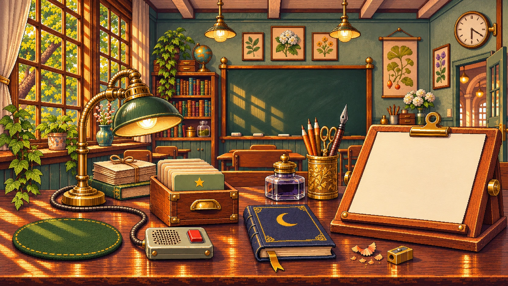

# HD pixel rooms and ambient animation

Start with **The Last Desk and original Mote**. From a fixed seat, the learner sees wind pass through the trees outside the left window, then a patch of sunlight shift on the chalkboard. Mote reacts when the learner draws a card or opens the notebook. The room supports any lecture.

The still below is the reference for composition, materials and pixel detail. The [earlier 12-second loop](previous-breeze.gif) moved mostly the indoor ivy, so put the strongest movement **beyond the glass**. The frontend has all three HD plates, the exterior frames and matched HD companion poses. See also the [shared scene and component handoff](../IMPLEMENTATION-HANDOFF.md).

## Build one breeze

The **1672 × 941** room plate is the common coordinate system. Trace the window panes once. Export a clean exterior backing, two or three leafy branch clusters with transparent surrounds, and a foreground window frame. Restore the pixels behind each displaced cluster so its resting silhouette never shows. The curtain, mullions, lamp, furniture, paper and tool hit areas keep their coordinates.

| Layer, back to front | Movement and treatment |
| --- | --- |
| Exterior backing and canopy | Distant trunks stay steady. The nearer leaves have a few discrete poses. One branch starts, its neighbor follows, and both settle. The exterior is clipped to the pane openings. |
| Frame and interior | The window frame sits over the leaves. The camera stays fixed for pointer, scroll and touch. Indoor ivy gets at most a small delayed response near the sill. |
| Sunlight on the board | A mask covers the lit panes on the left half of the board. One leaf shadow crosses a lit patch and fades as the branch settles. The chalk texture, mullion shadows and dark side stay. |
| Desktop and companion | Controls, paper, mascot feet and contact shadow share the stage coordinates. Text, focus rings and targets render separately and stay stable. |

**Timing.** In a 12-second loop, the canopy starts at second 2, a neighboring cluster follows about half a second later, and the board shadow comes in just after. Most movement settles by second 7. Try 4 to 8 native pixels at the nearest exterior leaf tips and 1 to 2 indoors, adjusted at laptop size until the exterior reads first. The first and last poses match. One timeline drives the gust and its shadow, independent of the cursor and study progress.

Study Bench uses its own window mask and catches the light on the bench. Projection Booth uses its projector or lamp as the light source. Approve each room's plate before deriving its layers.

## Mascots at their displayed size

1. Each character fits a **255 × 228** stage-pixel box on Last Desk and Study Bench, and **212 × 195** in Projection Booth, keeping its proportions and visual weight.
2. Draw at the room's native sampling scale, matching edge steps, cluster sizes and highlight width to the nearby card-box rim and brass fittings. A larger canvas does not raise apparent resolution.
3. Export lossless transparent frames on a common untrimmed canvas per character, with one ground anchor per pose and a ground shadow. Light each character from the room's light source, with an outline legible in afternoon light and booth lamplight.
4. Mote, Pip, Lumi, Inkcloud Yun, Moonlit Library Mote and Pagewing Spirit Mote each get idle, card-draw and notebook-open poses. Mote lifts its wings on a draw and dips its head toward the notebook. Pip bounces and Lumi tilts its lamp head. Each gesture ends in the anchored idle pose.

**Sign-off.** Review all six at desk size beside a same-scale crop of the box and mat, then a magnified nearest-neighbor crop for stair steps, blur, alpha fringes and jitter. At 100% zoom on standard and high-density displays, the smallest identifying mark reads as clearly as the neighboring props. Check each room and mascot pairing before offering that room in HD.

## Frontend rules

- The [appearance provider](../../../src/app/appearance.tsx) keeps room, companion and detail independent, with a default for older preferences. Switching artwork never remounts the session or clears drafts.
- The [scene shell](../../../src/app/scene.tsx) and [room tools](../../../src/app/room-tools.tsx) render one stage for the active room. Decoration is hidden from assistive technology and ignores the pointer. Stage and hotspots scale together. Thumbnails are stills, and only the active room's assets load.
- The [companion renderer](../../../src/app/companion.tsx) plays one gesture per card draw or notebook open, keyboard included, separate from listening, waiting and saving status. The learner keeps focus and can hide the companion.
- Playback uses cropped stepped sprite sheets and a masked shadow layer, with the still as first render and fallback. Ambient playback pauses in a hidden tab. Under reduced motion the resting art shows and the card, notebook or status text carries the action.
- Before rollout, check a full loop with the pointer parked, the loop seam and pane edges, one reaction per keyboard action, a narrow viewport, reduced motion, a hidden companion, a room switch mid-draft, a return from a background tab and missing animation assets.

## Implemented pass, 2026-11-04

New and older preferences default to HD Last Desk, with its four-pose canopy sheet and delayed chalkboard shadow. An HD review opens in the room scene. The source card box or lecture stand opens the study workspace, and Back to room restores the same draft. On mobile a separate row holds 44-pixel controls. All six companions have idle, draw and read images on a 255 × 228 canvas. The desk notebook shows the read pose and opens the notebook after a short pause.

The owner approved the Last Desk pass in chat. Study Bench reuses the canopy poses through its own windows, with a shadow on the desk. Projection Booth varies its lamp glow, with three dust motes and an evening tint on companions. Both await visual review at displayed size.

[The asset manifest](../../../src/app/assets/hd-pixel/manifest.json) records dimensions, poses, anchor and provenance. The build and typecheck passed, and 1,185 tests passed with four existing TODOs. Tab suspension on a physical laptop still needs a device check. The [review trail](../../trail/hd-pixel-room/browser-results.json), [Study Bench breeze](../../trail/hd-pixel-room/study-bench.gif) and [Projection Booth glow](../../trail/hd-pixel-room/projection-booth.gif) hold the evidence.
