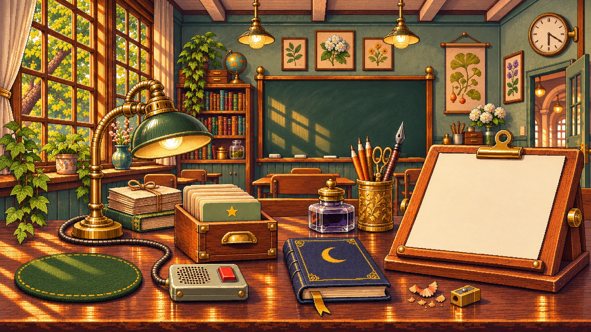

# HD pixel rooms and ambient animation

Start with **The Last Desk and original Mote**. From a fixed seat, the learner should see wind pass through the trees outside the left window. A moment later, a patch of sunlight shifts on the chalkboard. At the desk, Mote reacts when the learner draws a card or opens the notebook. The room supports any lecture.

The still below is the reference for composition, materials and pixel detail. The earlier loop establishes how quiet the interior can feel. Its main movement is on the indoor ivy. For the next pass, put the strongest movement **beyond the glass**. All three HD room plates, exterior animation frames and matched HD companion poses are now implemented. The implementation notes below describe the current frontend. [Earlier 12-second loop](previous-breeze.gif) · [Shared scene and component handoff](../IMPLEMENTATION-HANDOFF.md)

## Build one breeze

Use the **1672 × 941** room plate as the common coordinate system. Trace the visible window panes once. Export a clean exterior backing, two or three clusters of leafy branches with transparent surrounds, and a foreground window frame. Restore the pixels behind each displaced cluster so its resting silhouette never shows through. Preserve the curtain, mullions, lamp, furniture, paper and tool hit areas on their original coordinates.

| Layer, back to front | Movement and treatment |
| --- | --- |
| Exterior backing and canopy | Keep distant trunks steady. Draw a few discrete poses for the nearer leaves. Start one branch first, let its neighbor follow, then allow both to settle. Clip the entire exterior to the pane openings. |
| Frame and interior | Composite the window frame over the leaves. Keep the camera fixed for pointer, scroll and touch. Give indoor ivy at most a small delayed response near the sill. |
| Sunlight on the board | Mask the existing lit panes on the left half of the board. Let one irregular leaf shadow cross a lit patch and fade as the outside branch settles. Retain the chalk texture, mullion shadows and dark side of the board throughout. |
| Desktop and companion | Mount controls, paper, mascot feet and contact shadow in the same stage coordinates. Keep text, focus rings and interaction targets separately rendered and stable. |

**Suggested first timing pass.** In a 12-second study, hold briefly, start the canopy at second 2, let a neighboring cluster follow about half a second later, and bring the board shadow in just after it. Allow most of the movement to settle by second 7. Try 4–8 native pixels at the nearest exterior leaf tips and 1–2 at the indoor tips. Review at ordinary laptop size and adjust until the exterior reads first. Match the first and last pose and shadow strength. Use a shared timeline for this gust so light follows its cause. Keep it independent of cursor position and study progress.

For Study Bench, register a new mask to its own window and catch the returning light on the bench. For Projection Booth, use its existing projector or practical lamp as the light source. Author and approve each room’s HD plate before deriving its layers.

## Match the mascots at their displayed size

Use the new HD companion poses in all three rooms. The earlier standalone prototype used the same coarse sprites at both detail levels. The following checks govern the redrawn assets.

1. Place each character over the actual plate at its final footprint. The prototype fits a companion inside a **255 × 228** stage-pixel box on Last Desk and Study Bench, and **212 × 195** in Projection Booth. Use those as starting bounds. Preserve each character’s proportions and visual weight within the box.
2. Draw at the room’s native sampling scale. Compare the contour against the nearby card-box rim and the small highlights against the brass fittings. Match edge steps, cluster sizes and the width of a highlight. Enlarging the old sprite increases the size of every cluster. A larger PNG canvas alone does nothing for the apparent resolution.
3. Export transparent, lossless frames on a common untrimmed canvas per character. Store one foot or resting-point anchor for every pose, plus a ground shadow on the mat. Light the character from the room’s light source. Keep the outline legible against the mat in both afternoon light and booth lamplight.
4. Draw idle, card-draw and notebook-open poses for Mote, Pip, Lumi, Inkcloud Yun, Moonlit Library Mote and Pagewing Spirit Mote. For Mote, let the wings lift on a draw and the head dip toward the opening notebook. Give Pip a short bounce and Lumi a lamp-head tilt. Carry the same intent into each character’s anatomy. Finish each gesture in its anchored idle pose.

**Art sign-off.** Review a contact sheet of all six at actual desk size, beside a crop of the box and mat at the same scale. Then inspect a magnified nearest-neighbor crop for chunky stair steps, blurred contours, alpha fringes and frame-to-frame jitter. At 100% browser zoom on standard and high-density displays, the eye, wing edge or smallest identifying mark should read as clearly as the neighboring prop details. Check each room/mascot pairing before offering that room in HD.

## Connect it to the frontend

- Add a presentation detail preference in the existing appearance provider. Parse older saved preferences with a supported default. Keep room, companion and detail independently selectable. Switch the artwork without remounting the learning session or clearing drafts. [Appearance state](../../../src/app/appearance.tsx)
- Render one registered stage for the active room. Keep decoration hidden from assistive technology and transparent to pointer events. Scale the stage and its hotspots together on resize. Keep the reading surface accessible at narrow widths. Use a still for room-picker thumbnails and load only the active full-size plate, frames and companion. [Scene shell](../../../src/app/scene.tsx) · [Room tools](../../../src/app/room-tools.tsx)
- Trigger a one-shot companion gesture when a card is drawn or a notebook opens, including keyboard activation. Clear it on completion or skin change. Keep gesture state separate from listening, waiting and saving status. Preserve the learner’s focus and support hiding the companion. [Companion renderer](../../../src/app/companion.tsx)
- Use cropped sprite sheets with stepped frames and a small masked shadow layer for playback. Use the still as the first render and fallback. Pause ambient playback when the tab is hidden. With system or app reduced motion, show the resting artwork and communicate actions through the open card, notebook or existing status text.

## Review before rollout

1. Capture a full Last Desk loop at normal speed with the pointer parked. The reviewer should see movement outside first, then its effect on the chalkboard. Inspect the pane edges and the loop seam. Move the pointer corner to corner and confirm the camera stays fixed.
2. Review Mote at rest, mid-reaction and settled in the same composition. Draw twice and open the notebook by keyboard. Verify one reaction per action, readable feedback and a stable anchor.
3. Repeat on a narrow viewport and a high-density laptop. Test reduced motion, hidden companion, switching rooms during a draft, and returning from a background tab. Verify the lecture, notebook and focus still work with animation assets unavailable.
4. Approve the HD Last Desk and all six mascot sheets before extending the treatment to the two other rooms. Collect a still and one complete loop per room for visual review.

## Implemented frontend pass, 2026-11-04

The React frontend now offers a persisted HD pixel detail setting, defaulting to HD Last Desk for newly parsed or older preferences. Last Desk uses the registered plate, a four-pose exterior canopy sheet clipped to traced pane openings, and a delayed chalkboard shadow. Opening an HD review lands in the full room scene. Clicking the source card box or lecture stand opens the study workspace. Back to room restores the scene with the same draft and review state. Desktop tool buttons share the artwork coordinates. On mobile, a separate row provides 44-pixel controls. Source text and the learner’s response remain in readable HTML alongside the scene.

All six companions have new lossless idle, draw and read images, each exported on a 255 × 228 canvas with a shared ground anchor. Opening a source card, source stand or source control triggers the draw pose. Opening the desk notebook shows the read pose and navigates to the existing notebook after a short pause. These interactions use the real source and notebook routes. The card currently opens lecture evidence. Companion and room choices remain independent, and the app’s current activity continues alongside the gesture.

The Last Desk pass was approved in chat. Study Bench and Projection Booth now have HD plates and registered tool coordinates, with all six companions available. Study Bench uses the shared exterior canopy poses through its own traced window openings, followed by a shadow on the sunlit desktop. Projection Booth gently varies the auditorium and lamp glow with three drifting dust motes. Its companions receive a subtle evening tint. These new rooms are ready for visual review at their displayed size.

Asset dimensions, pose names, ground anchor and provenance are recorded in [the asset manifest](../../../src/app/assets/hd-pixel/manifest.json). The frontend pauses ambient playback on the document visibility event and honors system and app motion preferences. Direct browser checks cover the document event and playback state. Physical laptop tab suspension remains a device check.

Verification artifacts and the configurable browser check are in [the HD frontend review trail](../../trail/hd-pixel-room/browser-results.json). The production build and typecheck passed. The full test suite passed with 1,185 tests and four existing TODOs.

Review the implemented [Study Bench breeze](../../trail/hd-pixel-room/study-bench.gif) and [Projection Booth glow](../../trail/hd-pixel-room/projection-booth.gif). These crops were captured from the working frontend at normal playback timing.
