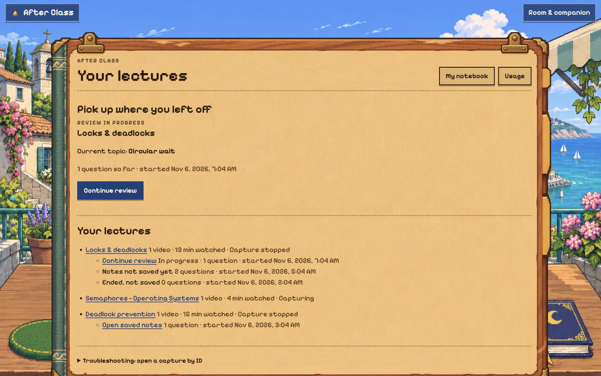
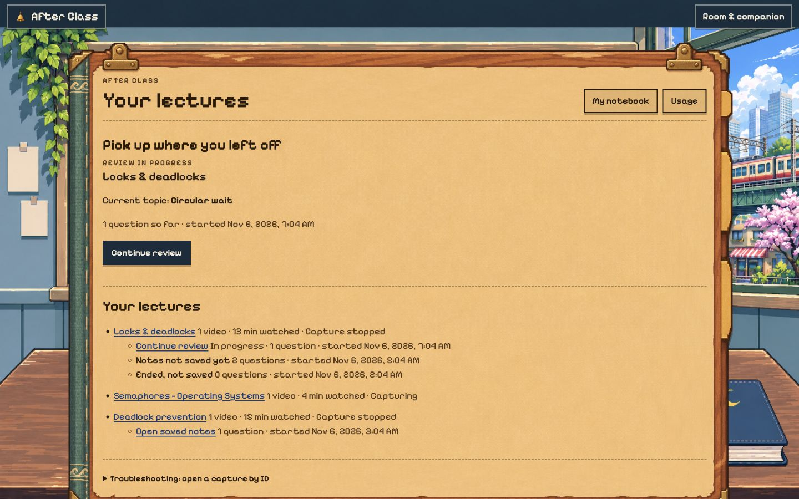
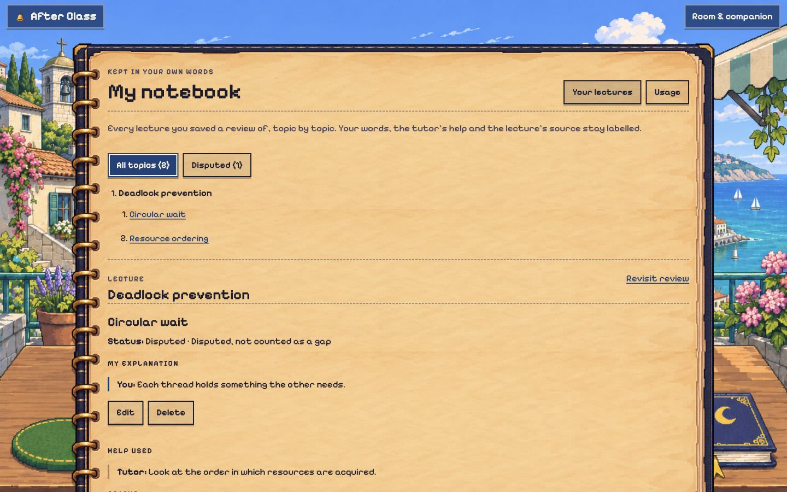
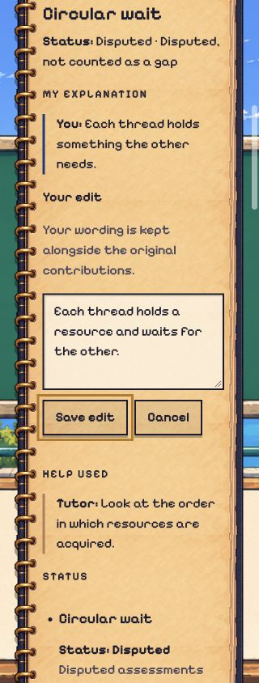
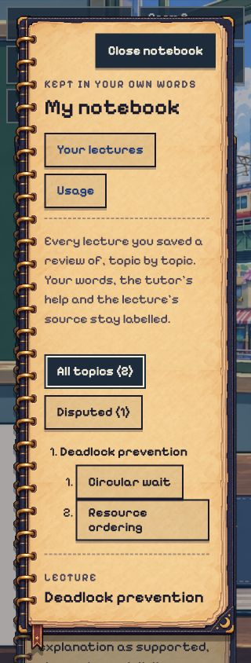
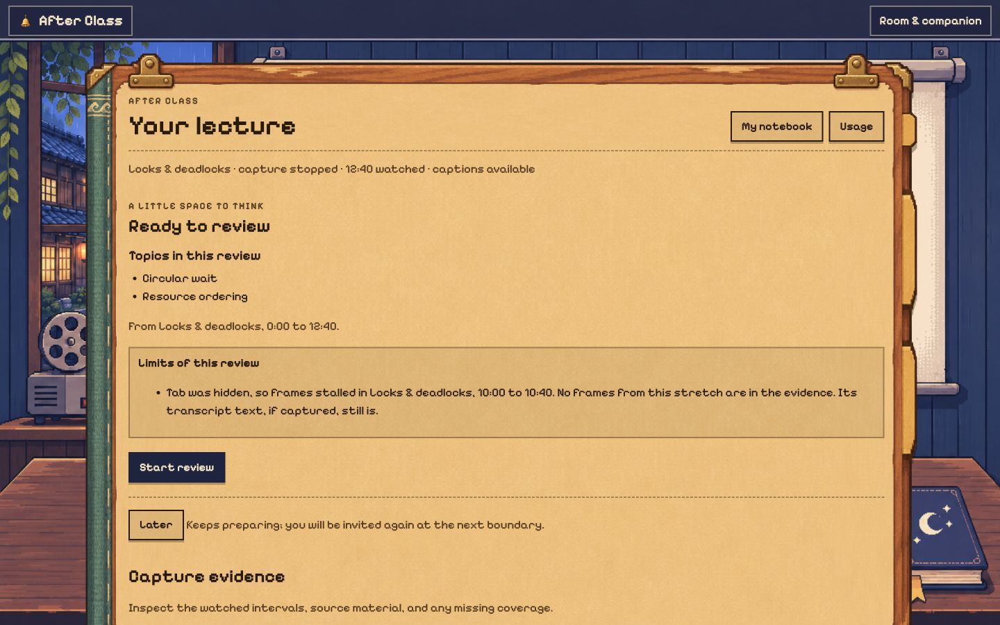
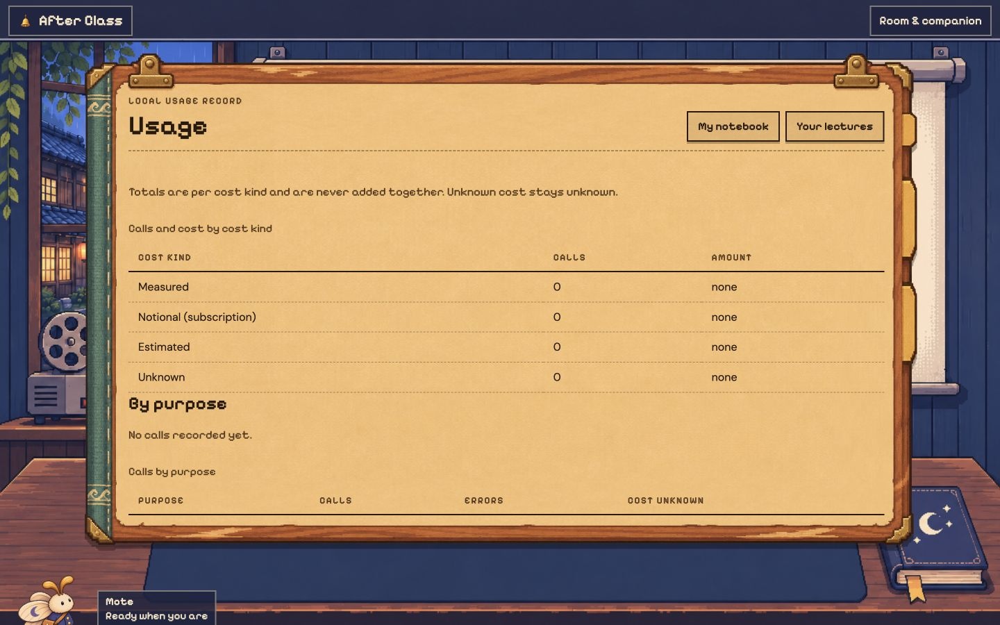
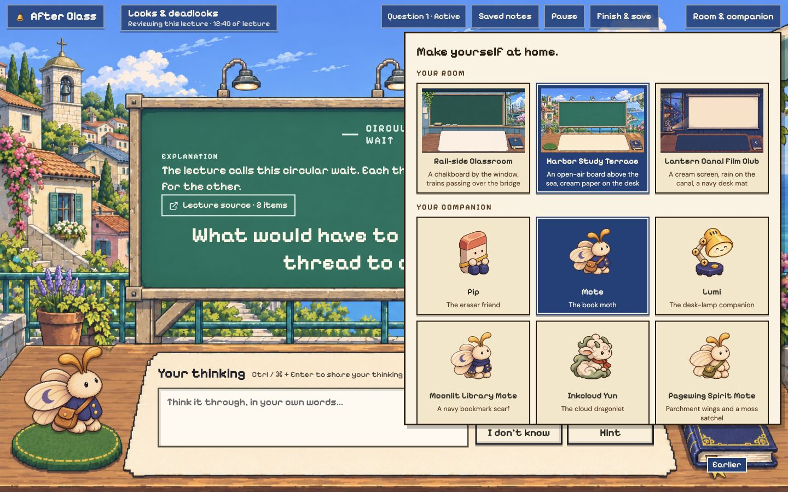
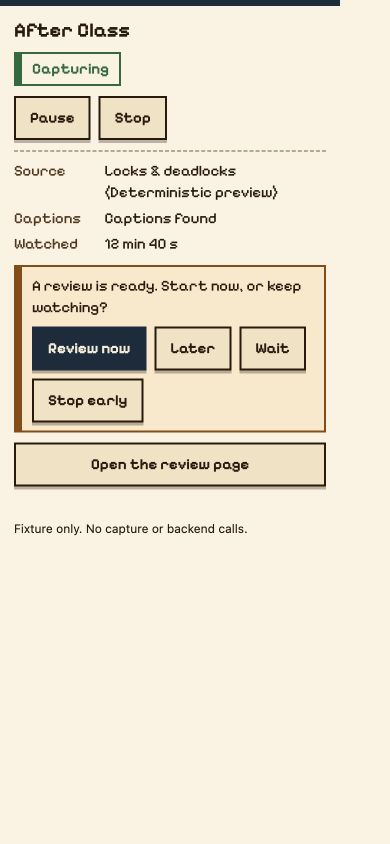
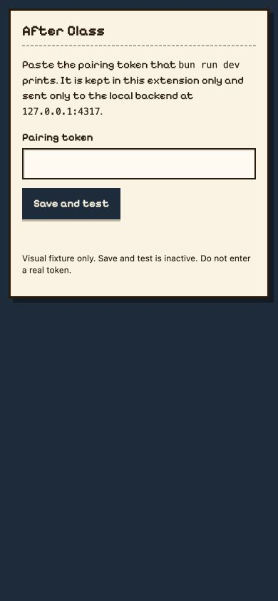

# Pixel interface consistency

Issue #133 extends the approved room design to the rest of the interface. Reviewed source commit `d0f8b22f93add270acabb9423ba34b0cbc7fbe2f` uses the existing three room plates, six companions, source folio and review notebook. No new illustrations or dependencies were added.

The source audit found flat backgrounds outside review, serif page headings, generic rounded cards, a separately drawn Saved notes dialog and unstyled extension pages. The README described the earlier card-box interaction and linked an old demo.

## Coverage

The browser review uses deterministic fixtures. It does not establish live capture reliability, provider quality or learning effectiveness.

| Screen or control | Result |
| --- | --- |
| Home and empty/error states | Folio over room art. Readable at desktop and 320px. No horizontal page overflow in narrow empty/error states. |
| Capture ready, processing and empty | Pixel controls and distinct readiness messages. Start review navigates to the review URL. The capture fixture keeps rendering capture because its scenario overrides routing, so the full handoff was checked separately through setup. |
| Review setup and active desk | Setup remains on the board and desk. Starting enters the first question and focuses it. |
| Source folio and history notebook | Both desk objects open their respective content. Escape from source returns focus to its opener. |
| Saved notes dialog | One notebook frame. At 320px, dialog width is 300px and its content width and scroll width are both 220px. Long content scrolls inside it. Escape returns focus to Saved notes. |
| Notebook, note editing and disputes | Edit/save/cancel work in fixtures. Pixel input, radio choices and decision action fit at 320px. Learner/tutor/source labels remain visible. Lecture frames compute image-rendering as auto. |
| Notebook empty/error states | Distinct empty and failed-load messages on notebook paper. Retry loads the topic record. |
| Usage | Matching folio and headings, with plain tabular data. At 320px both table containers have matching client and scroll widths of 237px. |
| Saved results and save errors | Failed save remains an error slip. A second fixture retry shows the saved notebook summary. |
| Room and companion picker | Current thumbnails and all six options are present. Pixel headings and selected-state contrast are readable. Original Harbor/Mote preferences restored. |
| Extension popup and options | Actual built HTML, stylesheet and fonts inspected through a temporary fixture. Real popup renderer exercised capture status, pause/resume, invitation and failed-start feedback. Options checked visually at 390px. |
| Desktop, narrow phone and three skins | Harbor and Rail home pages and Canal capture/usage/setup inspected at 1440 by 900. Notebook, dialog, empty/error pages and usage inspected at 320 by 844. |

The extension fixture uses local adapters. It does not call Chrome APIs or the backend. Pairing storage and Save and test behavior were not exercised. Temporary fixture data errors were corrected before the popup checks above. The not-found page and transient review-loading branch share the audited folio classes and passed compilation; they were reviewed in source rather than captured as separate browser states. No app-origin console errors were reported in the app review tab. Viewport overrides were reset and the temporary extension tab and server were closed.

## Screenshots

## Automated and independent review

Local Claude ran typecheck, the full test suite, the app build, the extension build and the fixture build. The final suite had 1,653 passing tests, four existing TODOs and zero failures. The added test checks that extension HTML and CSS refer only to local packaged resources, including the existing Pixelify font and its license. Existing tests were not weakened.

An independent source reviewer returned PASS for the commit above. It checked behavior preservation, frame ownership, dialog focus and scrolling, evidence rendering and extension packaging. Parent review exercised the browser scenarios in this document. Git diff whitespace checks passed. CI status is recorded on the PR.

## Documentation

README.md keeps its exact existing headings and section order. It now describes the folio as lecture evidence, the desk notebook as earlier exchanges, and Saved notes as saved records. The image is a fresh screenshot of the current build, labeled as fixture data. Setup commands were checked against repository scripts and backend startup code. The stale test-count paragraph and historical design handoff link were replaced with current verification and design references.

[Claude token usage](token-report.md) records this run separately from earlier design work. Existing artwork provenance remains in the [front-row design notes](../front-row/README.md).
