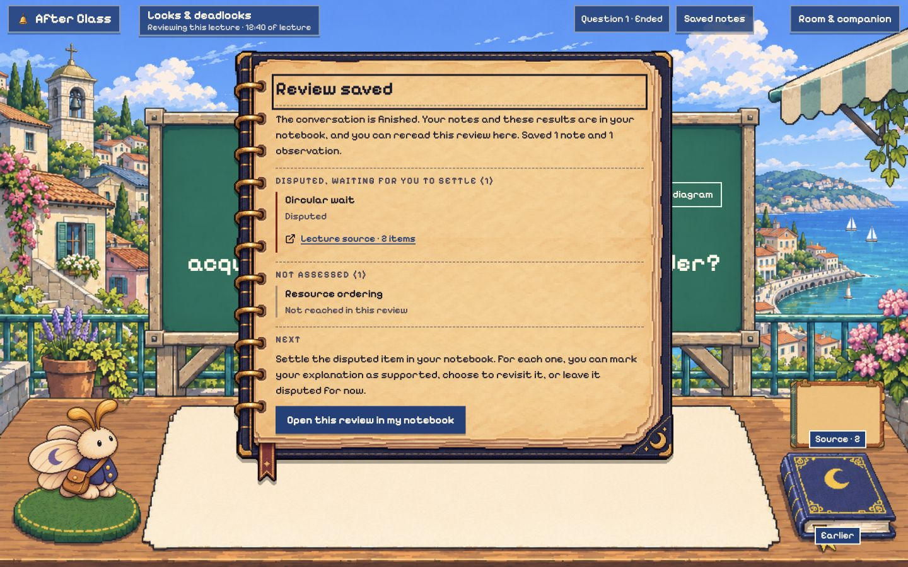
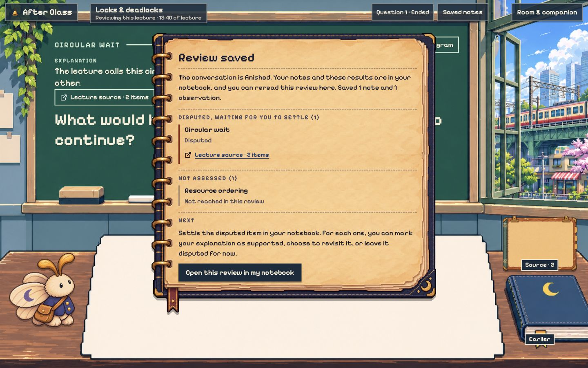
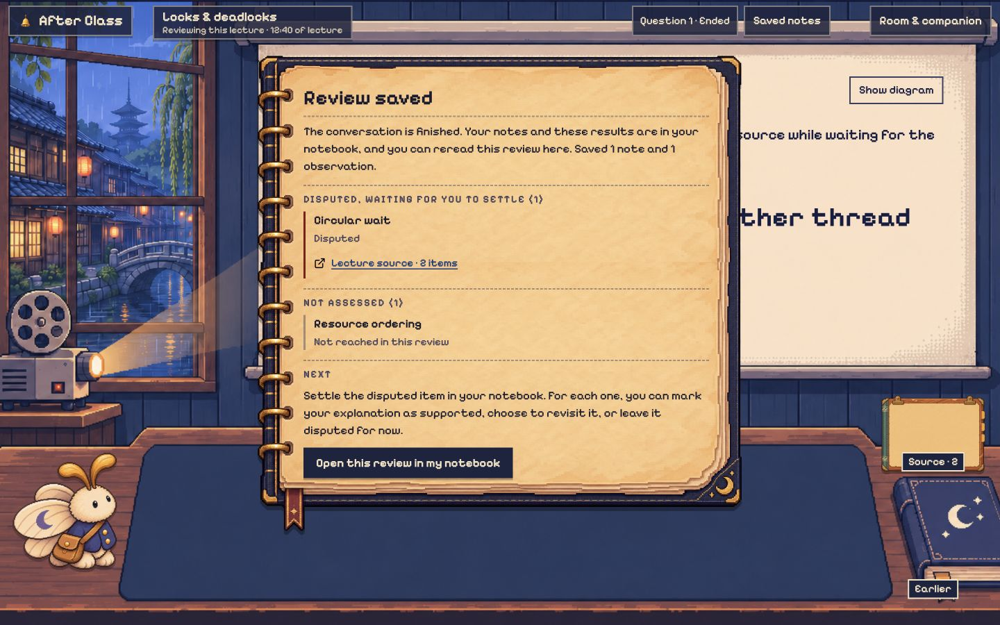
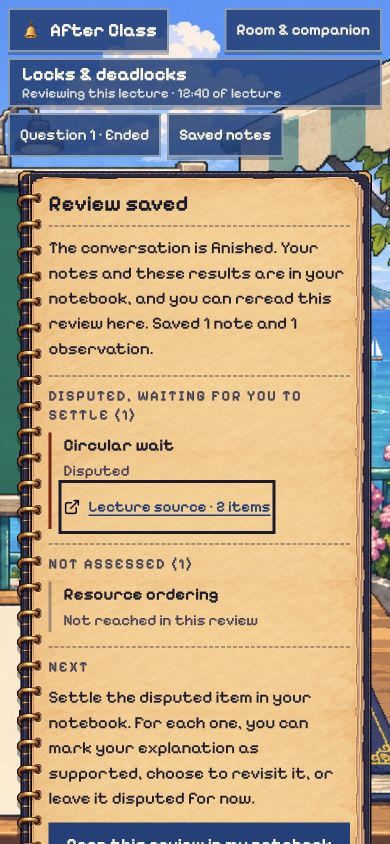
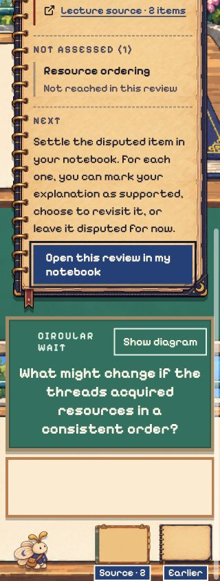

# Saved-results visual review

Reviewed code commit `1d1b790b3b1116c68270b9c3ff00baa3352da9ad` for issue #131.

The saved summary reuses the existing review notebook raster, frame measurements and ink. Its text remains selectable DOM text, with the room pixel font. The implementation changes presentation only.

## Browser checks

The local deterministic preview passed these checks. This is fixture evidence, not a live lecture or backend save test.

- At 1440 by 900, the summary fits in Harbor, Rail-side Classroom and Lantern Canal. The notebook frame, rings, bottom ribbon and action remain visible without overlapping text.
- At 390 by 844 and 320 by 844, the page scrolls naturally without horizontal overflow. At 320 pixels, the notebook action wraps within the page and remains reachable by keyboard.
- Saving focuses the Review saved heading. Saved counts, disputed labels and unassessed outcomes retain their text.
- The summary citation opens the matching source folio. Escape returns focus to that citation.
- The notebook action opens the matching review record and focuses its heading.
- The save-failure fixture does not show a success summary before saving. Its first retry shows the fixture error. Its second retry succeeds and displays the notebook summary.
- No browser console errors were reported in the review tab.

The desktop layout retains the existing bounded notices scroller. Longer summaries scroll the whole notebook, including its top frame. The separate notebook record page and failed-save notes keep their current styling.

## Screenshots

## Automated checks

Local Claude ran typecheck, the 41 focused completion, front-row and evidence tests, the app build and the preview build successfully. Parent review checked the diff and browser behavior. The parent ran `bun test` with 1,652 passing, 4 todo and 0 failures across 61 files. `git diff --check` also passed. See the PR for CI results.

## Provenance

No new art or dependency was added. The notebook comes from the room-object artwork documented in [the front-row design notes](../front-row/README.md). [Local Claude token usage](token-report.md) is recorded separately from the earlier room work.
