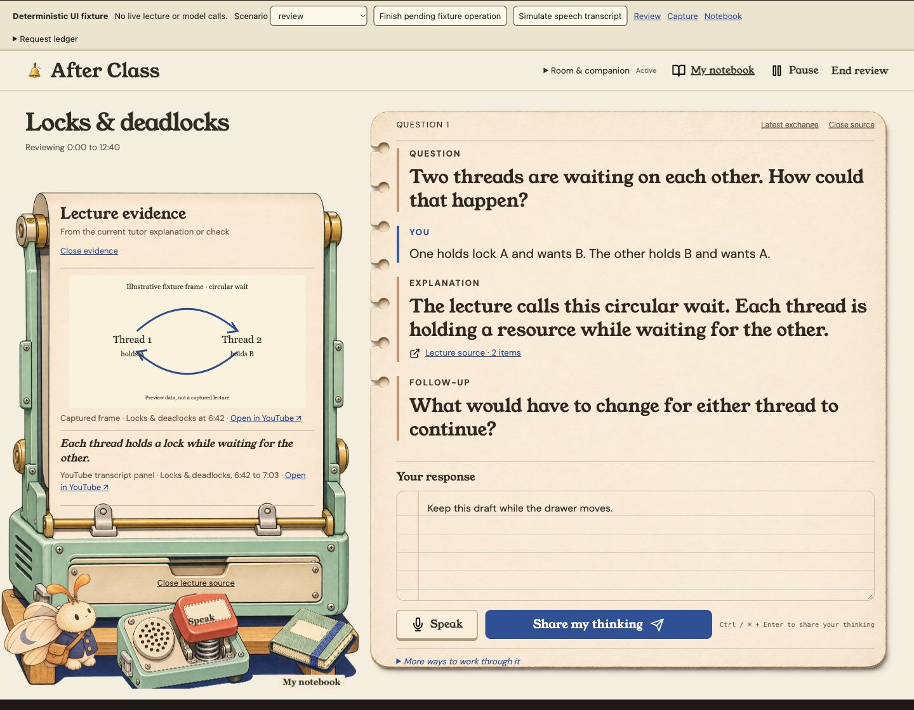
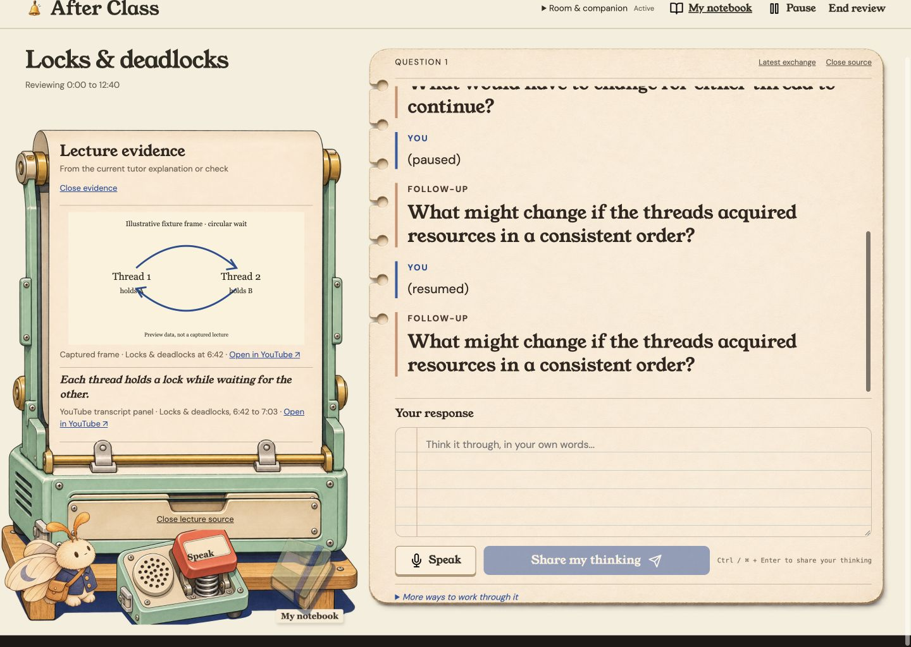
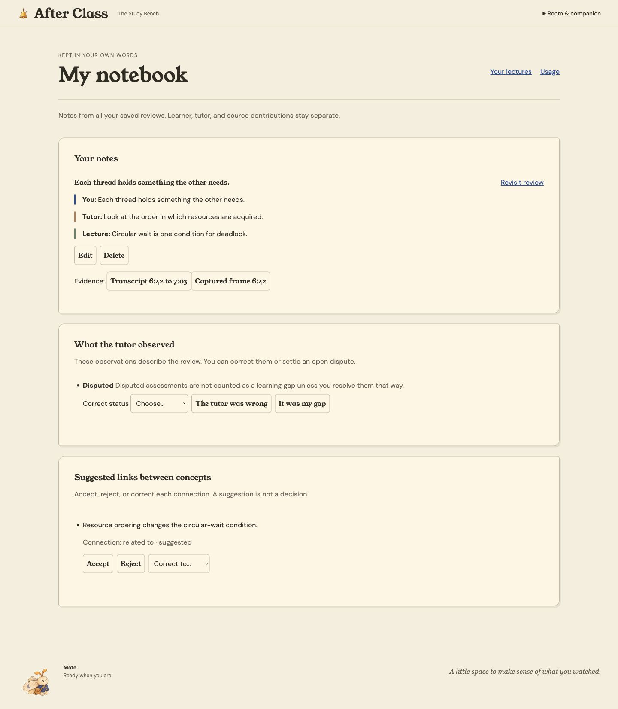
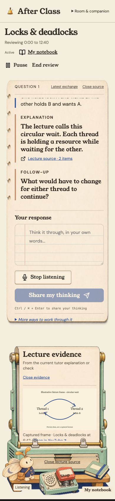

# Tactile interaction review

User annotations later replaced the whole-device press and drawer treatment below. See the [mechanical-control correction](../mechanical-controls/README.md).

The preview branch is `codex/tactile-motion`, stacked above the reference-fidelity correction. Final visual acceptance stays on base PR #44, and nothing here merges or deploys.

Run `bun scripts/preview-ui.ts` and open http://127.0.0.1:8770/?scenario=review&clean=1. Use Room & companion to choose a room. Motion follows the system preference, and Reduce motion overrides it explicitly. Omit `clean=1` to get deterministic scenario controls, fake speech and the request ledger. This preview makes no live microphone or provider calls.

## Inspected flow

1. **Review, healthy after fixes.** The desktop review was inspected before implementation. The masthead blocked pointer clicks on Pause and Resume, which keyboard testing alone had hidden. Its empty area now passes pointer events through, and the logo and appearance controls stay interactive. Pointer clicks on Pause and Resume both work. Pausing active speech emits `speech.stop` and the paused mascot state.
2. **Lecture source, healthy after fixes.** Before, the content just disappeared while the machine stayed still. The Study Bench drawer now moves its original illustrated front and handle, and the content slides in and out briefly. Closed evidence leaves the accessibility tree and navigation at once. On mobile, an overlap first let the transparent recorder target block the drawer. Smaller recorder bounds now keep them apart. At 390px the center of the source handle resolves to `source-handle`, the source opens and speech stays off. A typed draft stays the same across open and close.
3. **Speak and companion, healthy in fixture.** The physical recorder presses down while held with pointer, touch or keyboard, and stays down while listening. Composer Speak follows the same lifecycle. The code suppresses repeated keydown defaults. Mascots breathe slightly, lean while listening, shift while waiting, tuck while saving and settle while paused. These animations move the existing detailed raster body. They are not independent eye or wing rigging, and not a newly generated character animation. All three rooms were tested.
4. **Notebook, healthy after fixes.** Activating the book turns its illustration around the spine before navigation, and the notebook page then opens into view. This is a 380ms Web Animations cover turn followed by a 480ms page animation, and normal anchor and modified-click behavior still works. Back or another route cancels the pending navigation. Focus lands on My notebook, including with reduced-motion navigation. Note headings use the existing wording. Connection rationale replaces raw IDs, and citations show real frame and transcript timestamps. Metadata batches stay at 250 IDs, below wire limits. Citation focus on open and close was verified.
5. **Reduced motion and narrow layout, healthy in fixture.** Explicit Reduce motion gives no mascot loop, a zero source transition duration and immediate notebook navigation without page animation. The pressed state stays visible without movement interpolation. Mobile at 390×844 has a 390px page width, and the source and Speak targets act separately. No console errors appeared.

## Before and after evidence

The screenshots are static evidence. Live actions, computed transforms, focus checks and request ledger checks establish motion and state behavior. Screenshots alone cannot establish timing or full accessibility compliance.

Before: [review](01-current-review-full.jpg), [closed source](02-before-source-closed.jpg), [notebook](03-before-notebook.jpg).

After source movement and draft continuity:

After Speak and listening, with room-specific assets: [Last Desk](last-desk-listening.jpg), [Booth](projection-booth-listening.jpg), [Bench](study-bench-listening.jpg).

[Final Study Bench](study-bench.jpg) · [Paired source comparison](reference-comparison.jpg) · [Browser checks](browser-checks.json) · [Room checks](room-checks.json).

## Verification

The code commit is `167caaa`. The full suite had 941 passed, 4 pre-existing TODOs and 0 failures. Typecheck and the app, extension and fixture builds passed. After the final citation batching and focus edits, 49 focused tests and typecheck passed. CI checks the final published head.

Independent code verification ran navigation completion, competing routes, Back cancellation (including completion and microtask ordering), the no-animation fallback and the reduced-motion fallback. It found a stale completion edge, and invalidating the pending animation before cancel fixed it. It ran the real citation loader with 0, 1, 250, 251, 1000 and 1001 IDs. These made 0, 1, 1, 2, 4 and 5 requests, each with at most 250 IDs and each valid against the real wire parser. The loader checks for deleted evidence before cached metadata. Mutation identities stay unchanged.

Independent visual review used freshly captured screenshots, including the final paired comparison. It found raw IDs and unlabeled citations, and both were fixed. The final notebook evidence was recaptured only after opacity reached 1 and the metadata resolved. The parent drove the live browser because the visual worker could not reach IAB. The visual worker made no live-browser checks of its own.

Two P3 items remain. Long histories can start with a partly clipped previous line, and the page still has more than one way to close the source. Where the record API gives no lecture title, evidence labels use generic lecture provenance. Nobody tested real microphone, provider or captured-lecture behavior. The user's final visual acceptance is still pending.

Swarm roles were physical Speak and mascot implementation, notebook and audit implementation, independent code probes, and parent browser integration. Workers inherited the available model, and per-call dollar costs are unavailable.
