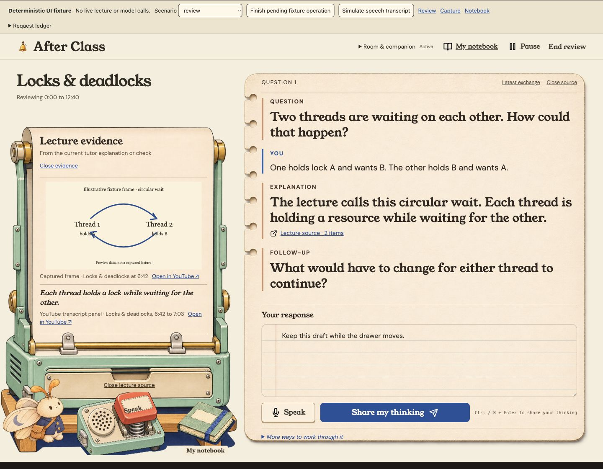
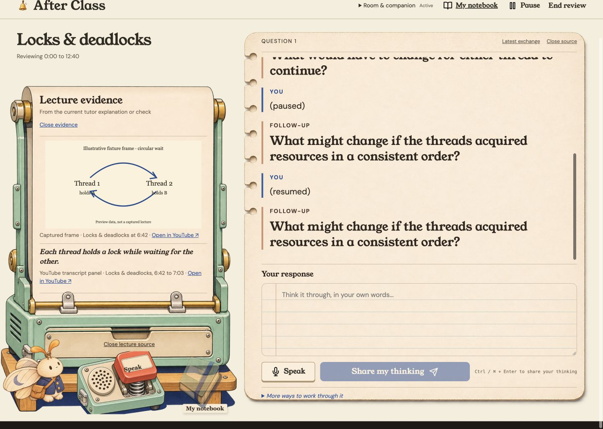
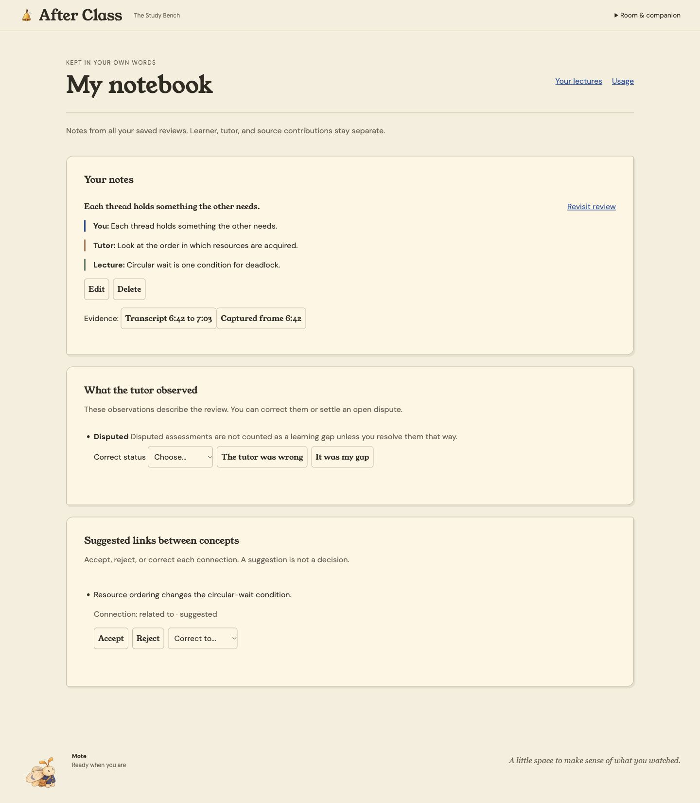
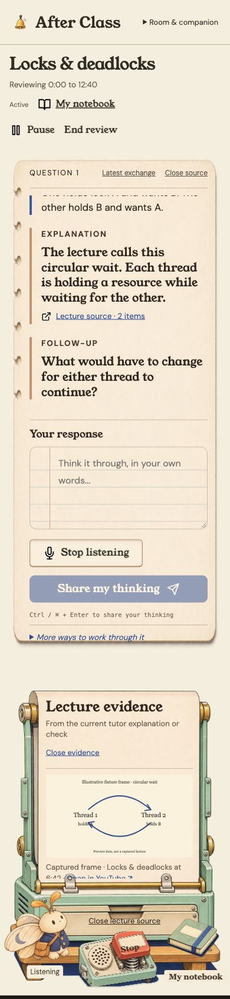

# Tactile interaction review

Preview branch: `codex/tactile-motion`, stacked above the reference-fidelity correction. Final visual acceptance remains on base PR #44. No merge or deployment.

Run `bun scripts/preview-ui.ts` and open http://127.0.0.1:8770/?scenario=review&clean=1. Use Room & companion to choose a room. Motion follows the system preference; Reduce motion is an explicit override. Omit `clean=1` for deterministic scenario controls, fake speech and the request ledger. This preview makes no live microphone/provider calls.

## Inspected flow

1. **Review — healthy after fixes.** Actual desktop review inspected before implementation. The masthead intercepted pointer clicks on Pause/Resume; keyboard activation alone had concealed this. Its empty area now passes pointer events through, while the logo and appearance controls remain interactive. Pointer Pause and Resume both verified; pausing active speech produces speech.stop and the paused mascot state.
2. **Lecture source — healthy after fixes.** Previously, content simply disappeared while the machine stayed still. The Study Bench drawer now moves its authentic illustrated front and handle; content enters/exits with a brief slide. Closed evidence is hidden from accessibility/navigation immediately. A mobile overlap initially let the transparent recorder target intercept the drawer; smaller recorder bounds separate them. At390px the source handle center resolves to source-handle, source opens and speech remains off. Typed draft remains unchanged across open/close.
3. **Speak and companion — healthy in fixture.** The physical recorder depresses while held with pointer, touch or keyboard and stays depressed while listening. Composer Speak reflects the same lifecycle. Repeated keydown defaults are suppressed. Mascots breathe subtly, lean while listening, shift while waiting, tuck while saving and settle while paused. These animate the existing detailed raster body; no claim of independent eye/wing rigging or a newly generated character animation. All three rooms tested.
4. **Notebook — healthy after fixes.** Activating the actual book turns its illustration around the spine before navigation; the notebook page opens into view. This is a 380ms Web Animations cover turn followed by a 480ms page animation, with normal anchor/modified-click behavior retained. Back or another route cancels pending navigation. Focus lands on My notebook, including reduced-motion navigation. Note headings use existing wording; connection rationale replaces raw IDs; citations show actual frame/transcript timestamps. Metadata batches stay at 250 IDs, below wire limits. Open/close citation focus verified.
5. **Reduced motion and narrow layout — healthy in fixture.** Explicit Reduce motion yields no mascot loop, zero source transition duration and immediate notebook navigation without page animation. Pressed state remains visible without movement interpolation. Mobile 390×844 has 390px page width; source/Speak targets act separately. Console errors: none observed.

## Before and after evidence

The screenshots are static evidence. Live actions, computed transforms, focus and request ledger checks establish motion/state behavior; screenshots alone cannot establish timing or full accessibility compliance.

Before: [review](01-current-review-full.jpg), [closed source](02-before-source-closed.jpg), [notebook](03-before-notebook.jpg).

After source movement and draft continuity:

After Speak/listening (room-specific assets): [Last Desk](last-desk-listening.jpg), [Booth](projection-booth-listening.jpg), [Bench](study-bench-listening.jpg).

[Final Study Bench](study-bench.jpg) · [Paired source comparison](reference-comparison.jpg) · [Browser checks](browser-checks.json) · [Room checks](room-checks.json).

## Verification

Code commit `167caaa`. Full suite: 941 passed, 4 pre-existing TODOs, 0 failures. Typecheck, app, extension and fixture builds passed. After the final citation batching/focus edits, 49 focused tests and typecheck passed. CI checks the final published head.

Independent code verification exercised navigation completion, competing routes, Back cancellation (including completion/microtask ordering), no-animation fallback and reduced-motion fallback. It identified a stale completion edge; invalidating the pending animation before cancel fixed it. It executed the actual citation loader with 0, 1, 250, 251, 1000, 1001 IDs: 0, 1, 1, 2, 4, 5 requests, each at most 250 and valid against the actual wire parser. Deleted evidence is checked before cached metadata. Mutation identities remain unchanged.

Independent visual review used fresh captured screenshots, including the final paired comparison. It identified raw IDs and unlabeled citations; both were fixed. Final notebook evidence was recaptured only after opacity reached 1 and metadata resolved. The parent controlled the live browser because the visual worker could not access IAB. No independent-live-browser claim is made for that worker.

Remaining P3: long histories can begin with a partially clipped previous line; multiple close-source affordances remain. Evidence labels use honest generic lecture provenance where the record API supplies no lecture title. Real microphone, provider and captured-lecture behavior were not exercised. User final visual acceptance remains pending.

Swarm roles: physical Speak/mascot implementation, notebook/audit implementation, independent code probes, parent browser integration. Workers inherited the available model; per-call dollar costs are unavailable.
