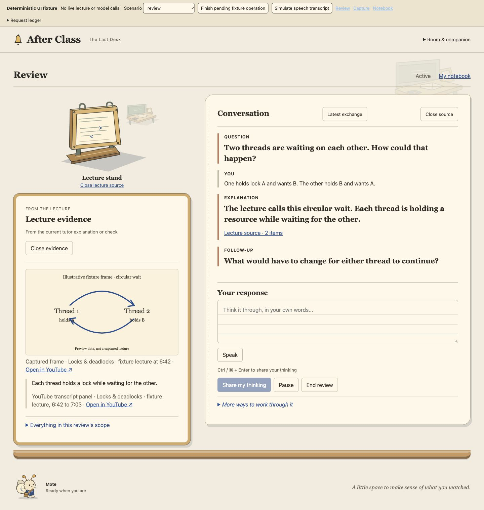
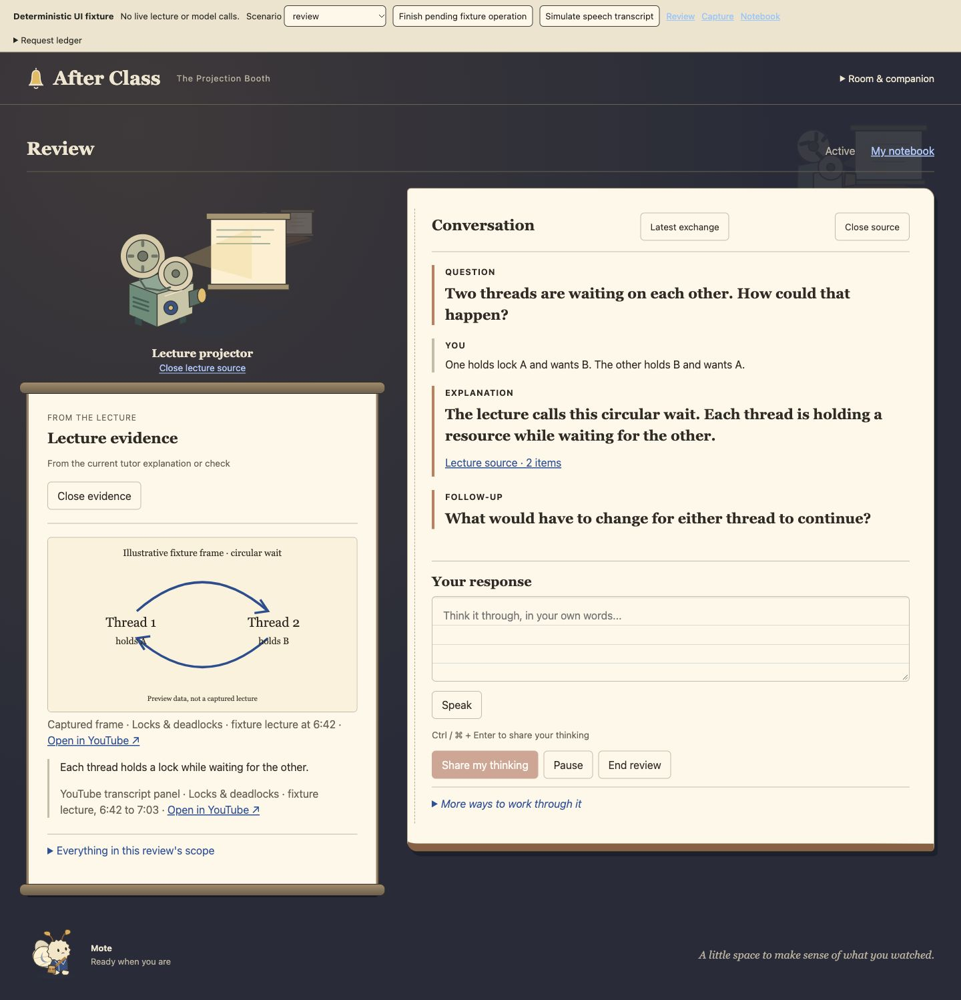
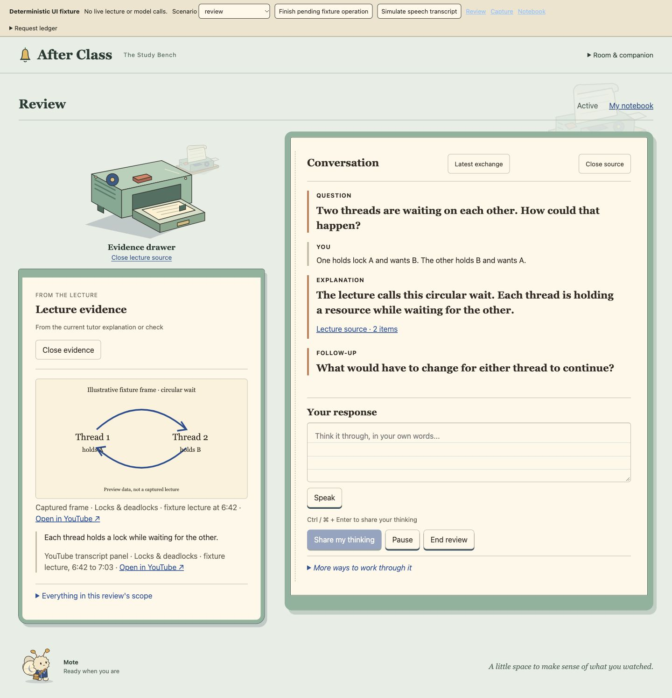
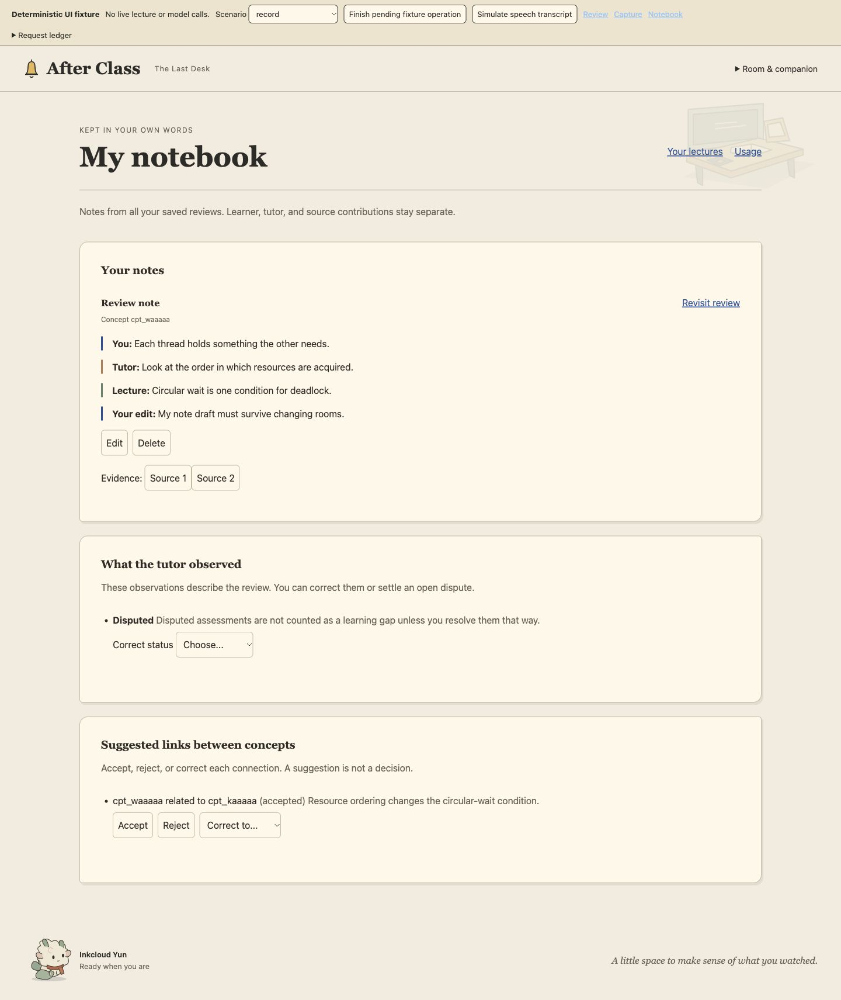
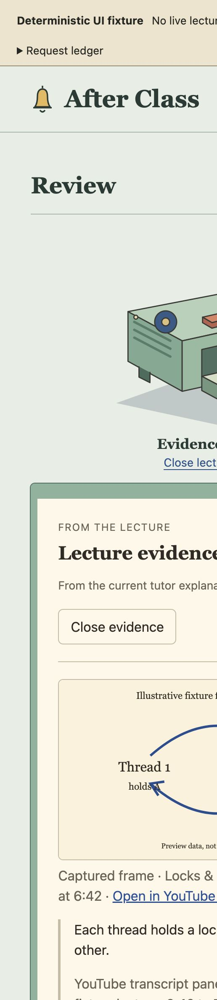

# Frontend review

[The reference fidelity correction](../frontend-v2/README.md) replaces the artwork and visual review evidence here. The controller and fixture verification below stays as historical evidence.

The implementation stack starts at [PR #44](https://github.com/DerekHertz/after-class/pull/44), above the approved design handoff in [#42](https://github.com/DerekHertz/after-class/pull/42). Follow the dependent PRs in order. Nothing in this stack authorizes merging or deployment. The owner gives final visual approval.

## Run the full interface

Check out the top branch and run the fixture server from the repository root.

```sh
git switch codex/frontend-validation
bun scripts/preview-ui.ts
```

Open the localhost address that the command prints. The server binds to loopback. It uses the real React screens, scene shell, controllers, preference storage and in-memory unsent store with a deterministic fake API. It involves no Jev, Claude, microphone permission, captured lecture or live provider. The illustrated lecture frame is fixture data. This preview server is separate from the production application build.

Choose a scenario in the preview toolbar. The streaming and saving scenarios hold an operation pending on purpose. Use **Finish pending fixture operation** to release it. **Speak** starts simulated input, and **Simulate speech transcript** supplies text. The request ledger shows every fake API request, including turn IDs, so you can check that a room switch sends no unintended requests. Reloading a scenario resets its fake data. Appearance preferences stay local to the browser.

## Implemented

- One stable workspace with three independent room skins and six selectable vector companion appearances.
- Versioned appearance preferences, recovery from invalid values, a fallback when storage is unavailable, companion visibility and reduced motion.
- Chronological dialogue, history that follows new turns when scrolled to the bottom, an anchored composer, an IME-safe single-submit shortcut, and the existing valid review actions.
- Historical evidence pinning, restoring the current source, source and transcript provenance, missing and error states, explicit scope browsing, and focus return.
- Capture readiness and partial coverage, honest estimates, record editing and attribution, observation corrections, dispute resolution, concept-link decisions and usage views.
- Dimensional room source tools whose open state and semantic action control the same evidence panel.

The production artwork is an original scalable vector adaptation of the approved raster studies. The app does not show those boards as screenshots behind invisible controls. This is an implementation, not visual sign-off or a claim of exact image parity.

## Verification evidence

Independent swarm reviews checked appearance boundaries, review provenance and continuity, and capture and record behavior. Follow-up verification fixed dark-room contrast and moved CSS loading into the HTML entrypoints without weakening the module-boundary check. Each review records a specific commit in the decision trail.

- [Eighteen appearance combinations](appearance-combinations.json) kept the same typed draft. During these switches, the browser request ledger stayed at its initial review, capture and evidence reads.
- [Narrow scenario smoke checks](narrow-scenarios.json) rendered 17 named states at 390px without horizontal page overflow. This checks rendering, not every interaction in each state.
- Browser interaction checks covered pinned historical evidence during a pending reply, automatic evidence restoration from 6:42 to 8:00, citation focus return, keyboard submit, identical turn IDs on retry, simulated speech across appearance switches, save-failure recovery, and notebook edits and learner decisions.
- Unit and controller tests cover invalid preferences, unavailable storage, valid actions, guards for IME, repeat and empty input, real per-turn evidence, and retry and save semantics. Browser tests use fake speech. Real microphone behavior in Chrome on macOS remains unverified.
- The production build emits absolute `/app/` asset URLs. The fixture server supports direct deep paths for review and notebook inspection.
- Final local checks passed with Bun 1.4.4. They covered typecheck, 941 tests passed with 4 existing TODOs and zero failures, and the extension, application and fixture builds. GitHub CI uses the repository's pinned Bun 1.4.3. PRs #44 through #47 passed CI at their restacked heads.

## Desktop captures

Each capture uses deterministic data, not a real learner session.











[Narrow review capture](narrow-review.png)

## Remaining operator gate

The owner's final visual review belongs on the base implementation PR. That review needs to cover the companion identities, scene materials, tool illustrations, typography, spacing and responsive composition. Passing code checks implies no visual approval and no result on capture feasibility, model accuracy or learning effectiveness.
