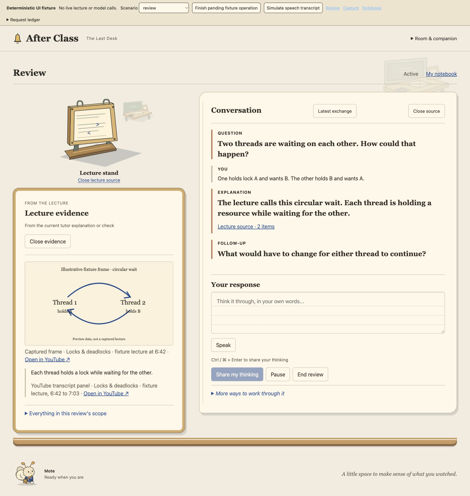
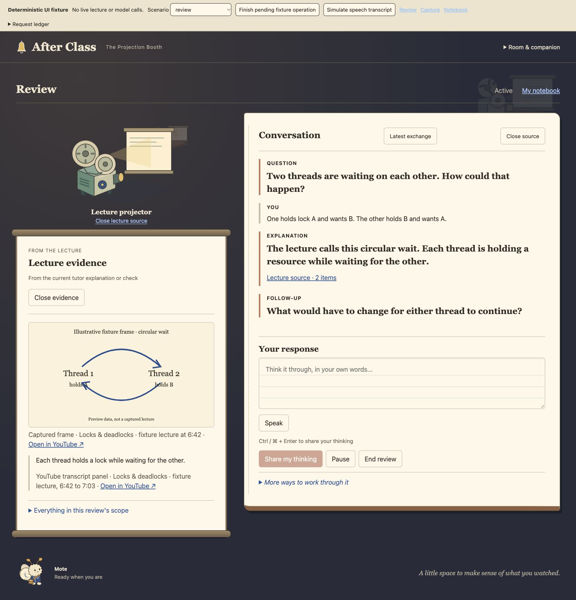
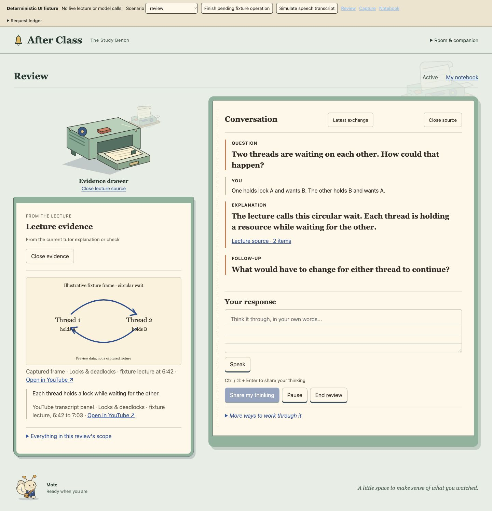
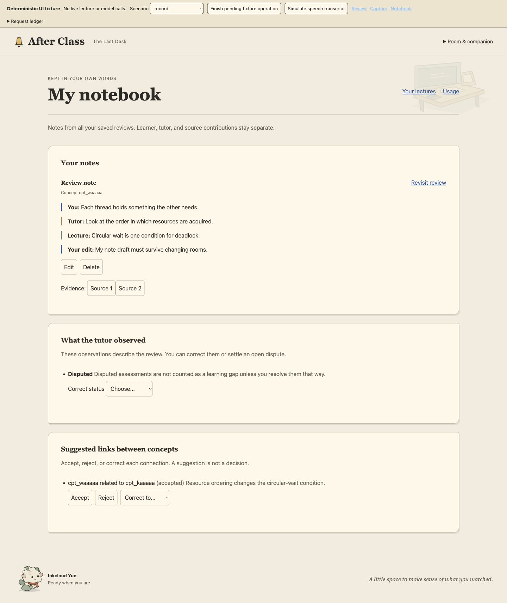
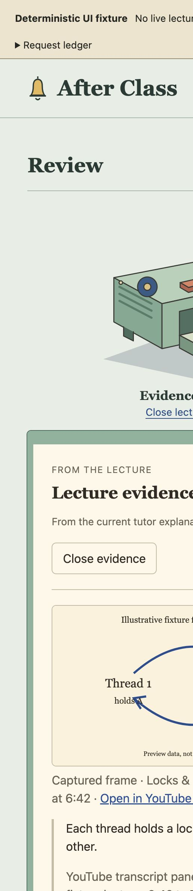

# Frontend review

Artwork and visual review evidence are superseded by [the reference fidelity correction](../frontend-v2/README.md). The controller/fixture verification below remains historical evidence.

The implementation stack starts at [PR #44](https://github.com/DerekHertz/after-class/pull/44), above the approved design handoff in [#42](https://github.com/DerekHertz/after-class/pull/42). Follow the dependent PRs in order. Nothing in this stack authorizes merging or deployment. Derek owns final visual approval.

## Run the full interface

Check out the top branch and run the fixture server from the repository root.

```sh
git switch codex/frontend-validation
bun scripts/preview-ui.ts
```

Open the localhost address printed by the command. The server binds to loopback. It uses the real React screens, scene shell, controllers, preference storage and in-memory unsent store with a deterministic fake API. No Jev, Claude, microphone permission, captured lecture, or live provider is involved. The illustrated lecture frame is fixture data. This harness is separate from the production application build.

Choose a scenario in the preview toolbar. Streaming and saving scenarios have a deliberately pending operation. Use **Finish pending fixture operation** to release it. **Speak** starts simulated input; **Simulate speech transcript** supplies text. The request ledger shows every fake API request, including turn IDs, so a room switch can be checked for unintended requests. Reloading a scenario resets its fake data. Appearance preferences remain local to the browser.

## Implemented

- One stable workspace with three independent room skins and six selectable vector companion appearances.
- Versioned appearance preferences, invalid-value recovery, unavailable-storage fallback, companion visibility and reduced motion.
- Chronological dialogue, bottom-aware history following, an anchored composer, an IME-safe single-submit shortcut, and the existing valid review actions.
- Historical evidence pinning, current-source restoration, source and transcript provenance, missing/error states, explicit scope browsing, and focus return.
- Capture readiness and partial coverage, honest estimates, record editing and attribution, observation corrections, dispute resolution, concept-link decisions and usage views.
- Dimensional room source tools whose open state and semantic action control the same evidence surface.

The production artwork is an original scalable vector adaptation of the approved raster studies. Those boards are not used as screenshots behind invisible controls. This is implementation, not visual sign-off or a claim of exact image parity.

## Verification evidence

Independent swarm reviews checked appearance boundaries, review provenance and continuity, capture and record behavior. Follow-up verification repaired dark-room contrast and moved CSS loading into the HTML entrypoints without weakening the module-boundary check. Each review records a specific commit in the decision trail.

- [Eighteen appearance combinations](appearance-combinations.json) retained the same typed draft. The browser request ledger remained at its initial review, capture and evidence reads during these switches.
- [Narrow scenario smoke checks](narrow-scenarios.json) rendered 17 named states at 390px without horizontal page overflow. This checks rendering, not every interaction in each state.
- Browser interaction checks covered pinned historical evidence during a pending reply, automatic evidence restoration from 6:42 to 8:00, citation focus return, keyboard submit, identical turn IDs on retry, simulated speech across appearance switches, save-failure recovery, and notebook edits and learner decisions.
- Unit/controller tests cover invalid preferences, unavailable storage, valid actions, IME/repeat/empty guards, genuine per-turn evidence, and retry/save semantics. Browser tests use fake speech; real macOS Chrome microphone behavior remains unverified.
- The production build emits absolute `/app/` asset URLs. The fixture server supports direct deep paths for review and notebook inspection.
- Final local checks passed with Bun 1.4.4: typecheck, 941 tests passed, 4 existing TODOs, zero failures, extension build, application build and fixture build. GitHub CI uses the repository's pinned Bun 1.4.3. PRs #44 through #47 passed CI at their restacked heads.

## Desktop captures

Each capture uses deterministic data, not a real learner session.











[Narrow review capture](narrow-review.png)

## Remaining operator gate

Derek's final visual review belongs on the base implementation PR. The companion identities, scene materials, tool illustrations, typography, spacing and responsive composition need that review. No visual approval, capture feasibility, model accuracy or learning-effectiveness result is implied by passing code checks.
