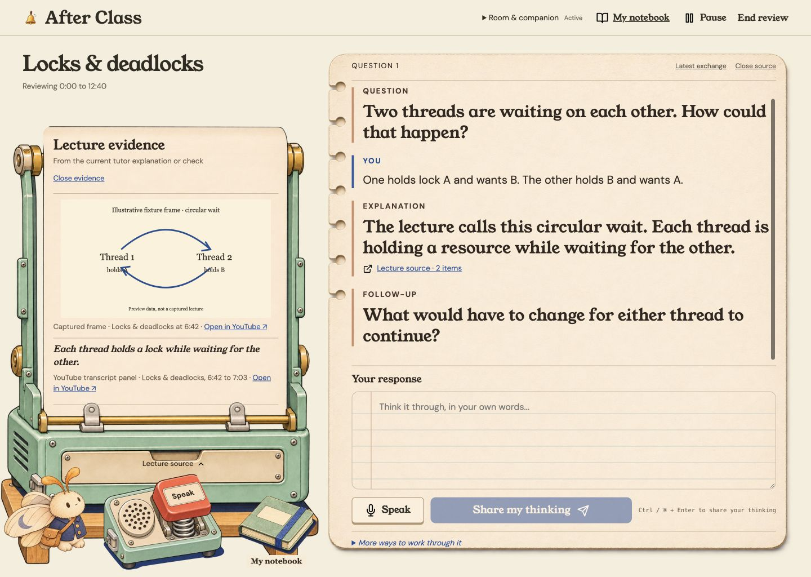
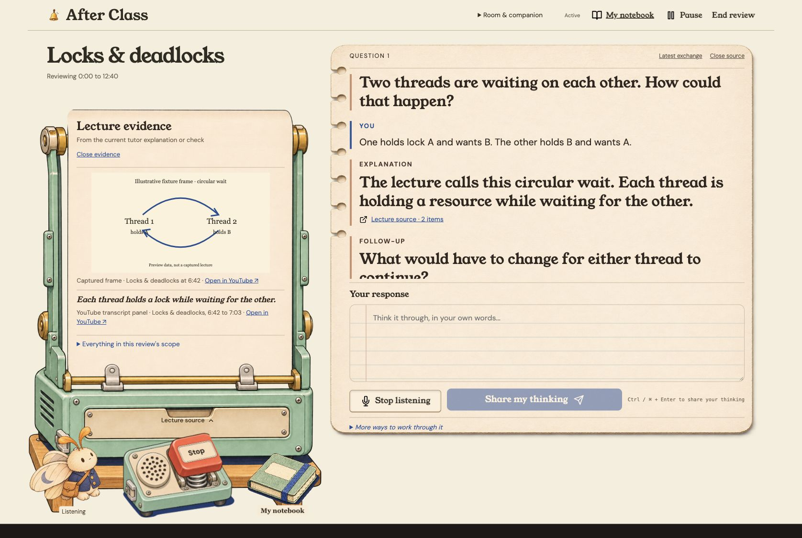
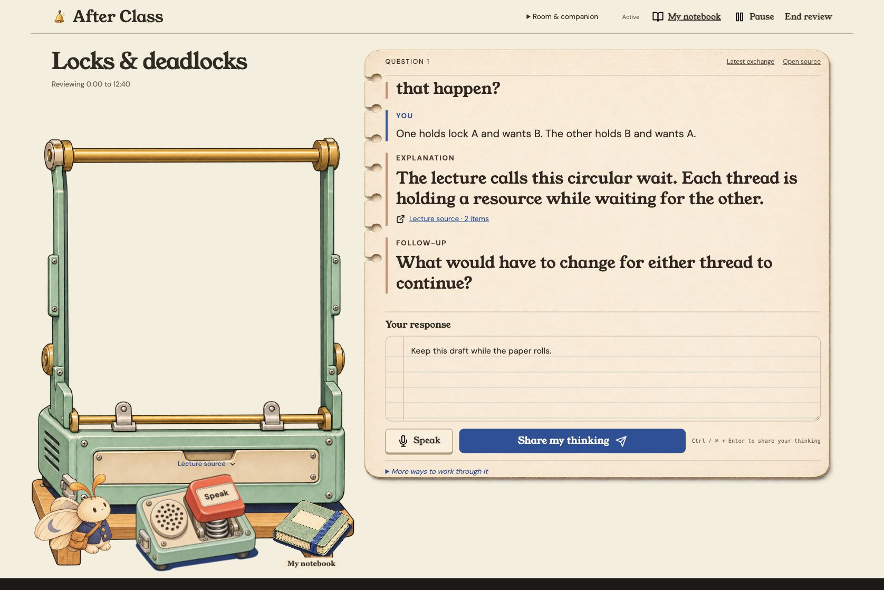

# Mechanical-control correction

Code: `9030574`. Preview branch: `codex/mechanical-controls`, above the tactile-motion PR. Final visual acceptance remains on base PR #44. No merge or deployment.

Run `bun scripts/preview-ui.ts`; open http://127.0.0.1:8770/?scenario=review&clean=1. Choose Study Bench to review the annotated machine. Omit `clean=1` for the fake speech controls and ledger. Real microphone/provider behavior is not exercised by this fixture.

## Annotation fixes

1. **Clunky source control.** Removed the duplicated full-stage drawer-front crop and 14px displacement. The actual machine is a paper feeder: the sheet now retracts toward the upper roller, exposing the transparent frame opening. Its fixed faceplate has a short Lecture source label and directional chevron. Native accessible actions say Roll up/Unroll lecture source.
2. **Only the red key moves.** Replaced flattened recorder art with independently generated body/key layers. Native key is separate from decorative body. Bench and Last Desk keys travel 7px while listening; bodies and wrappers have transform:none. Booth orange actuator travels 3px; its 44px target contains a mic/pause icon, with a static Voice legend on the fixed plate.
3. **Speak label alignment.** Bench Speak/Stop sits on the cream insert inside the red key, inherits its travel and matches its face angle. Last Desk text sits on the orange key. Sprite placement uses consistent full-canvas coordinates; native button bounds follow the actual key, rather than the whole device.
4. **Mascot roaming and emotes.** Remains lower priority, as requested. Existing subtle breathing/poses remain; this change makes no claim of roaming or expressive sprite animations. Buttons and the paper mechanism take MVP priority.
5. **Paper rolling during scrolling.** Native evidence scrolling drives decorative paper grain and the side roller. A passive listener coalesces updates into one animation frame, writing CSS variables without React state updates. Actual evidence content scrolls once; it is not translated again. Reversed, keyboard and programmatic scrolling use the same native offset. Reduced motion freezes decorative feed/roller movement while preserving ordinary evidence scrolling and immediate pressed state.

## Fresh evidence

[Combined before/after](comparison.jpg): PR53 left, corrected UI right, both 1440×1024. Main artwork and notebook style retained. Fresh full-frame annotation checks also used 1676×954; mobile 390×844.

Other checks: [Last Desk](last-desk-pressed.jpg), [Booth final desktop](booth-fixed-desktop.jpg), [Booth final mobile](booth-fixed-pressed.jpg), [Bench mobile](mobile-pressed.jpg), [scrolled paper](paper-feed-scrolled.jpg), [room measurements](room-checks.json), [browser checks](browser-checks.json).

`iteration-1.jpg` records the first composite before the native key bounds were reduced to the actuator. `projection-booth-pressed.jpg` records the rejected intermediate Booth live-label placement; it is superseded by booth-fixed captures. Static images establish layout/state; motion was verified in the live browser through native actions and computed travel.

## Implementation and assets

The premise that a flattened illustration could provide independent physical movement failed the user review. The structural fix is separate raster layers and separate native key buttons, not stronger transforms on the whole prop.

Seven transparent component assets were generated with built-in imagegen: body/key pairs for Bench, Last Desk and Booth, plus the paperless source-machine body. Prompt manifests: [control layers](../../../src/app/assets/controls-v3/prompts.json), [source body](../../../src/app/assets/controls-v3/source-body.prompt.json). No cropping/resizing scripts or new packages were used. Generative edits preserve registration closely; they are not pixel-exact extractions. Source-body alpha was decoded: the window and exterior are transparent; posts/drawer hardware opaque.

The existing source artwork supplies the paper and cropped roller face; the existing notebook raster supplies subtle paper grain. All content remains actual DOM. No screenshot UI, custom drawn replacement illustration, or live provider is involved.

## Verification

- Full suite: 941 pass, 4 existing TODOs, 0 failures; typecheck, app and extension builds passed. After final Booth layers/legend: independent typecheck, 99 focused tests/357 assertions and production build passed. CI runs against the final published head.
- Independent code verdict PASS on exact code head `9030574`; reviewed TS/CSS/HTML/PNG bytes match the verified snapshot. All 27 emitted non-data CSS asset URLs resolve under /app/; small key assets embedded by Bun are retained.
- Native button centers activated all three recorders. Bench key computed translate 0px 7px with body and wrapper transform:none; Booth key 0px 3px. Mobile Bench target 70×58px and label lies inside key bounds; Booth target 44×44px.
- Source roll/unroll retains the draft and does not start speech. Native source scrollTop 276 yielded paper-feed 276px and roller-turn 11.5rad. Independent effect probes cover initial loading/scene guards, latest-value frame coalescing, listener removal and frame cancellation.
- Initial modulo 128 texture travel caused a discontinuity; removed. Independent 127→128→129→276 offset checks now remain continuous.
- Reduce motion: key/paper transition durations 0s, spool transform:none and static paper texture. Mobile page width 390 equals viewport 390. Browser console errors: none observed.
- Independent final screenshot verdict PASS after resolving Booth’s changing-label-on-fixed-plate mismatch. No remaining proven P0/P1/P2 in reviewed captures. Final visual approval remains Derek's; code verification does not substitute for that.

Swarm slices: component asset extraction, independent code/effect verification, independent screenshot comparison and parent browser integration. Agents inherited the available model; per-call dollar costs are unavailable. Existing pending unrelated `.DS_Store` files were preserved.
