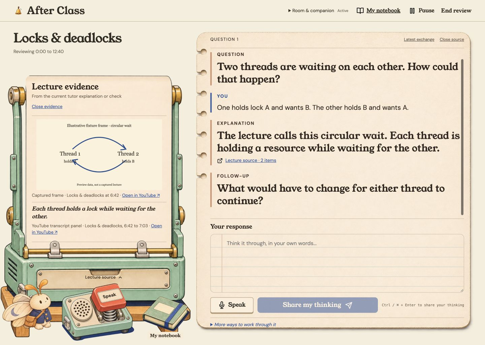
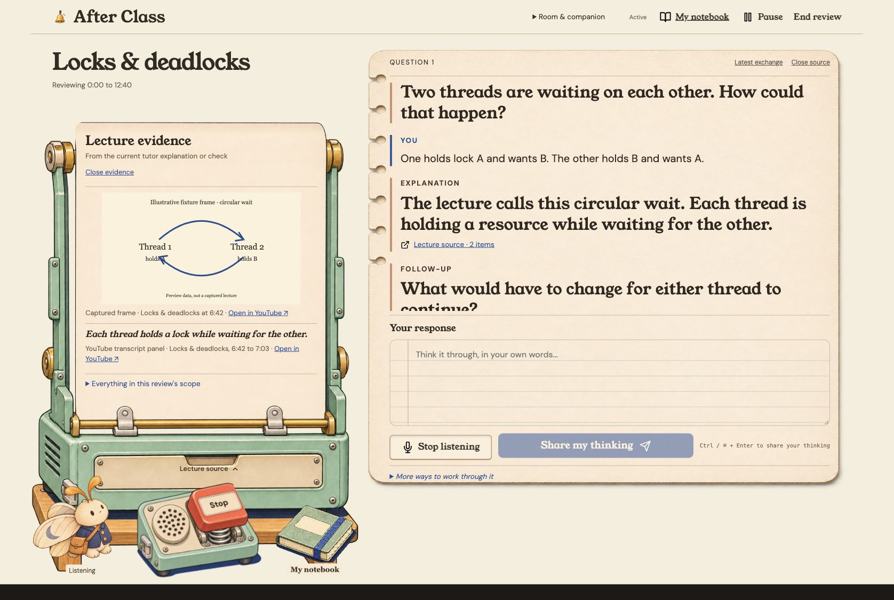
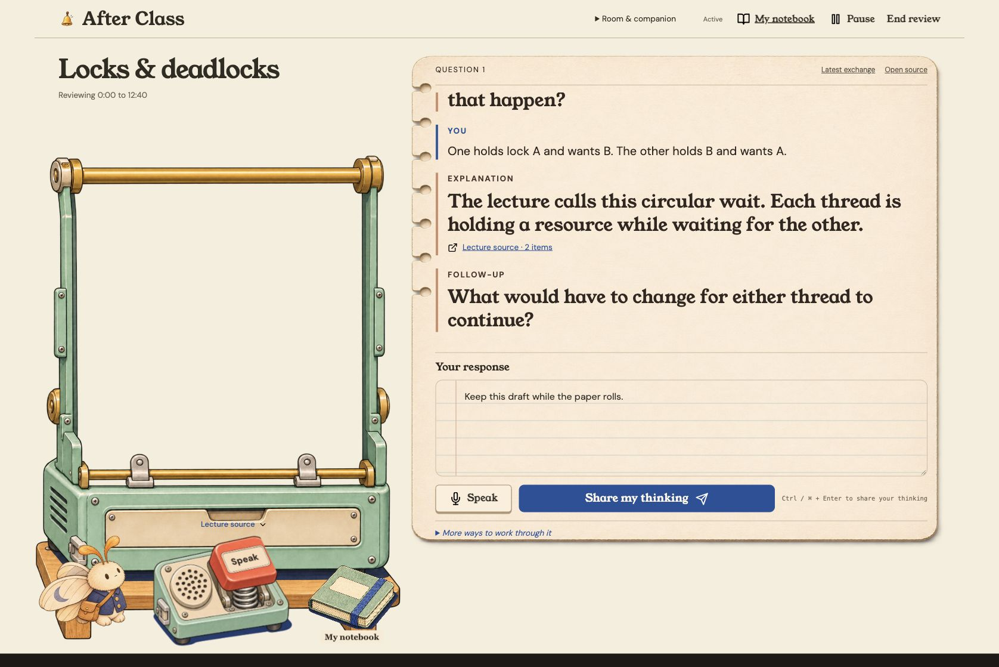

# Mechanical-control correction

The code is at `9030574`, and the preview branch is `codex/mechanical-controls`, above the tactile-motion PR. Final visual acceptance stays on base PR #44, and nothing here merges or deploys.

Run `bun scripts/preview-ui.ts` and open http://127.0.0.1:8770/?scenario=review&clean=1. Choose Study Bench to review the annotated machine. Omit `clean=1` to get the fake speech controls and ledger. This fixture does not exercise real microphone or provider behavior.

## Annotation fixes

1. **Clunky source control.** The duplicated full-stage drawer-front crop and its 14px displacement are gone. The machine is a paper feeder, so the sheet now retracts toward the upper roller and shows the transparent frame opening. Its fixed faceplate has a short Lecture source label and a directional chevron. The native accessible actions read Roll up lecture source and Unroll lecture source.
2. **Only the red key moves.** Separately generated body and key layers replaced the flattened recorder art. The native key is separate from the decorative body. The Bench and Last Desk keys travel 7px while listening, and bodies and wrappers have `transform: none`. The Booth's orange actuator travels 3px. Its 44px target holds a mic and pause icon, with a static Voice legend on the fixed plate.
3. **Speak label alignment.** The Bench Speak and Stop label sits on the cream insert inside the red key, moves with the key and matches its face angle. The Last Desk text sits on the orange key. Sprite placement uses consistent full-canvas coordinates. Native button bounds follow the key itself, not the whole device.
4. **Mascot roaming and emotes.** This stays lower priority, as requested, behind the buttons and the paper mechanism. The existing slight breathing and poses remain, and this change adds no roaming or expressive sprite animation.
5. **Paper rolling during scrolling.** Native evidence scrolling drives the decorative paper grain and the side roller. A passive listener merges updates into one animation frame and writes CSS variables without React state updates. The evidence content scrolls once and is not translated a second time. Reversed, keyboard and programmatic scrolling use the same native offset. Reduced motion freezes the decorative feed and roller movement, and keeps ordinary evidence scrolling and the immediate pressed state.

## Fresh evidence

The [combined before and after](comparison.jpg) shows PR53 on the left and the corrected UI on the right, both at 1440×1024. The main artwork and notebook style are unchanged. Fresh full-frame annotation checks also used 1676×954, and mobile used 390×844.

Other checks: [Last Desk](last-desk-pressed.jpg), [Booth final desktop](booth-fixed-desktop.jpg), [Booth final mobile](booth-fixed-pressed.jpg), [Bench mobile](mobile-pressed.jpg), [scrolled paper](paper-feed-scrolled.jpg), [room measurements](room-checks.json), [browser checks](browser-checks.json).

`iteration-1.jpg` records the first composite, before the native key bounds shrank to the actuator. `projection-booth-pressed.jpg` records the rejected intermediate placement of the Booth's live label, and the booth-fixed captures replace it. Static images establish layout and state. Motion was verified in the live browser through native actions and computed travel.

## Implementation and assets

The user review disproved the premise that a flattened illustration could move its parts independently. The structural fix is separate raster layers and separate native key buttons, not stronger transforms on the whole prop.

The built-in imagegen tool generated seven transparent component assets. They are body and key pairs for Bench, Last Desk and Booth, plus the paperless source-machine body. The prompt manifests are [control layers](../../../src/app/assets/controls-v3/prompts.json) and [source body](../../../src/app/assets/controls-v3/source-body.prompt.json). The work used no cropping or resizing scripts and no new packages. Generative edits keep registration close, but they are not pixel-exact extractions. Decoding the source-body alpha showed a transparent window and exterior, with opaque posts and drawer hardware.

The existing source artwork supplies the paper and the cropped roller face, and the existing notebook raster supplies a faint paper grain. All content stays real DOM. The work involves no screenshot UI, no custom-drawn replacement illustration and no live provider.

## Verification

- The full suite had 941 pass, 4 existing TODOs and 0 failures, and typecheck and the app and extension builds passed. After the final Booth layers and legend, an independent typecheck, 99 focused tests with 357 assertions and the production build passed. CI runs against the final published head.
- The independent code verdict was PASS on exact code head `9030574`. The reviewed TS, CSS, HTML and PNG bytes match the verified snapshot. All 27 emitted non-data CSS asset URLs resolve under `/app/`, and Bun keeps the small key assets it embeds.
- Native button centers activated all three recorders. The Bench key's computed translate was 0px 7px, with body and wrapper at `transform: none`. The Booth key's was 0px 3px. The mobile Bench target is 70×58px with the label inside the key bounds, and the Booth target is 44×44px.
- Rolling and unrolling the source keeps the draft and does not start speech. A native source `scrollTop` of 276 gave a paper feed of 276px and a roller turn of 11.5rad. Independent effect probes cover the initial loading and scene guards, latest-value frame merging, listener removal and frame cancellation.
- The first version moved the texture modulo 128, which caused a jump, so it was removed. Independent offset checks at 127, 128, 129 and 276 now stay continuous.
- With Reduce motion, key and paper transition durations are 0s, the spool has `transform: none` and the paper texture is static. The mobile page width of 390 equals the 390 viewport. No browser console errors appeared.
- The independent final screenshot verdict was PASS, after a fix to the Booth's changing label on a fixed plate. The reviewed captures show no remaining proven P0, P1 or P2. Final visual approval stays with the owner, and code verification does not replace it.

Swarm slices were component asset extraction, independent code and effect verification, independent screenshot comparison and parent browser integration. Agents inherited the available model, and per-call dollar costs are unavailable. Unrelated pending `.DS_Store` files were left alone.

## Follow-up: content feeds under the upper edge

The next user annotation said the page content should roll upward, instead of the side fitting spinning. The artificial rotating fitting is gone. Native content scrolling and the existing sheet retraction remain. A 14px mask on the upper edge appears only after scrolling, so content feeds beneath that edge. Returning to the top removes the mask. This is a small feed cue, not a simulated 3D paper curl. The roller screenshots and measurements above are now history.

Verified in the live browser at 1303×954. A source `scrollTop` of 744 set `scrolled=true`, turned on the upper-edge mask and left zero spinning layers. Home returned `scrollTop` to 0, with `scrolled=false` and `mask: none`. Typecheck and 49 focused tests passed. Fresh evidence is the [content feed edge](content-feed-edge.jpg) capture.
